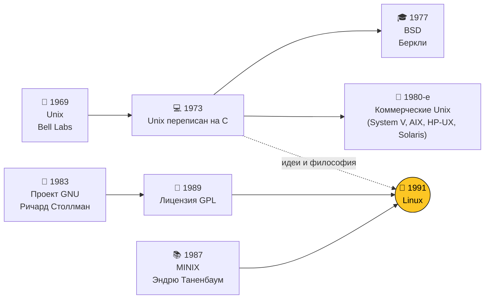
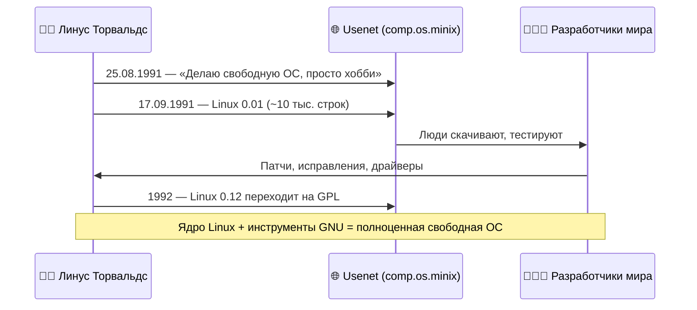
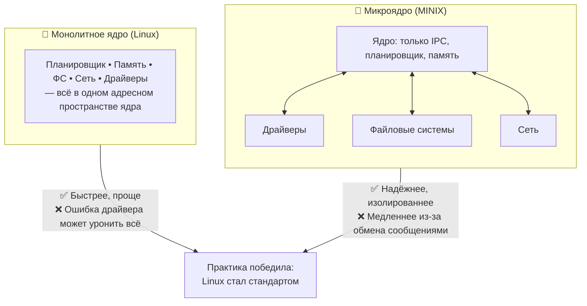
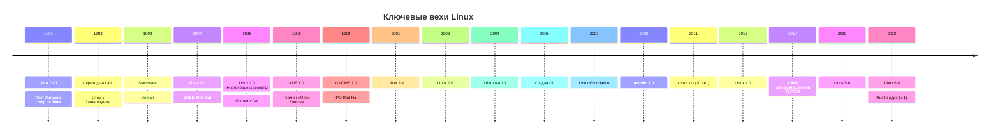
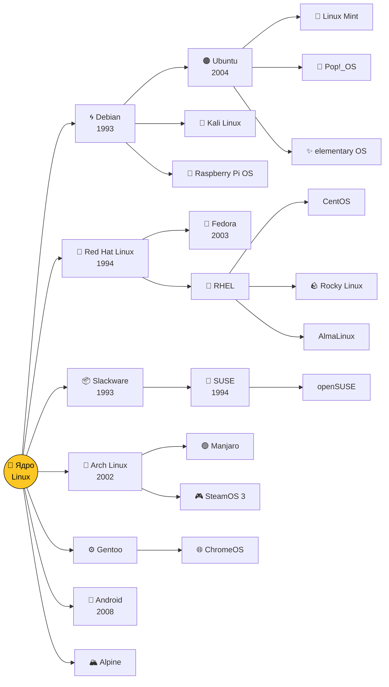
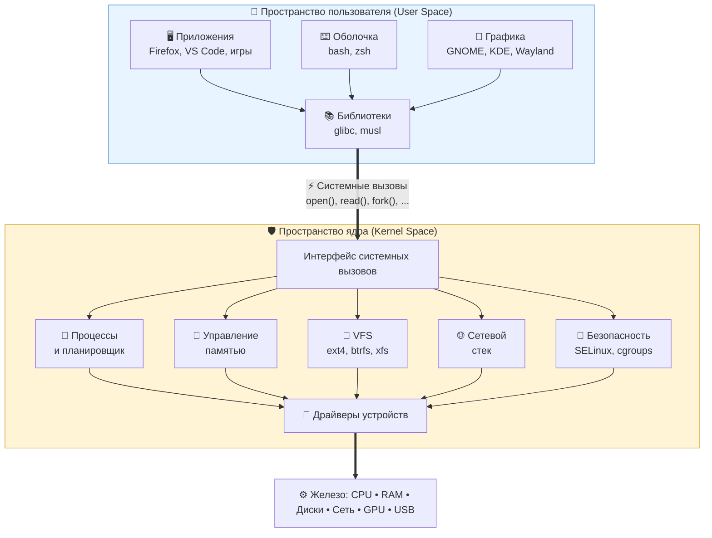
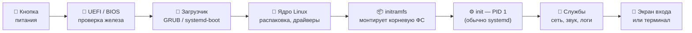
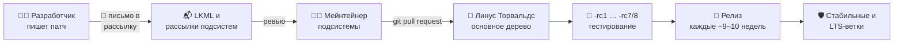
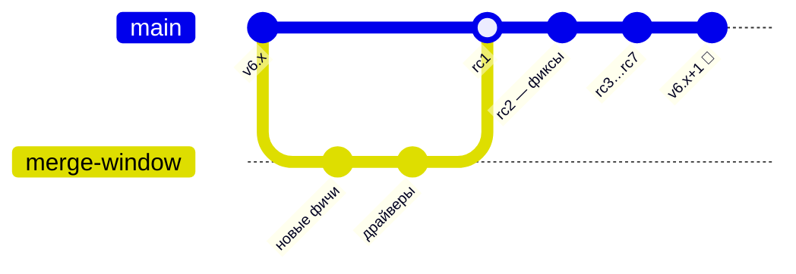
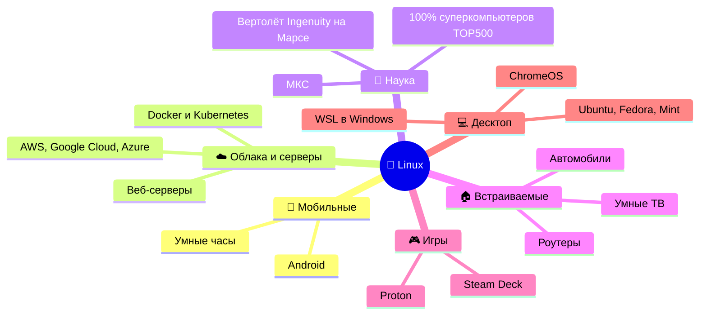

<div align="center">

# 🐧 История Linux

### От «просто хобби» студента из Хельсинки до операционной системы, на которой работает мир


</div>

---

## 📖 Содержание

1. [Предыстория: Unix и GNU](#-предыстория-unix-и-gnu)
2. [Рождение Linux (1991)](#-рождение-linux-1991)
3. [Хронология развития](#-хронология-развития)
4. [Как растёт ядро](#-как-растёт-ядро)
5. [Генеалогическое древо дистрибутивов](#-генеалогическое-древо-дистрибутивов)
6. [Как устроен Linux](#-как-устроен-linux)
7. [Как Linux загружается](#-как-linux-загружается)
8. [Как ядро разрабатывается сегодня](#-как-ядро-разрабатывается-сегодня)
9. [Где Linux сегодня](#-где-linux-сегодня)
10. [Интересные факты](#-интересные-факты)
11. [Что почитать](#-что-почитать)

---

## 🏛 Предыстория: Unix и GNU

Linux появился не на пустом месте. Он стоит на плечах двух гигантов — **Unix** и проекта **GNU**.



| Год | Событие | Почему это важно |
|:---:|---|---|
| **1969** | Кен Томпсон и Деннис Ритчи создают **Unix** в Bell Labs | Заложены принципы: «всё есть файл», маленькие утилиты, конвейеры |
| **1973** | Unix переписан на языке **C** | ОС впервые стала переносимой между разными компьютерами |
| **1977** | В Беркли появляется **BSD** | Свободная ветка Unix, предок FreeBSD и (частично) macOS |
| **1983** | Ричард Столлман объявляет проект **GNU** | Цель — полностью свободная Unix-подобная ОС |
| **1985** | Основан **Фонд свободного ПО (FSF)** | Юридическая и идейная опора свободного софта |
| **1987** | Эндрю Таненбаум выпускает **MINIX** | Учебная ОС, на которой учился и сам Линус |
| **1989** | Выходит **GNU GPL** | Лицензия «копилефт»: код остаётся свободным навсегда |

> 💡 К 1991 году у GNU было почти всё — компилятор GCC, оболочка Bash, утилиты, — **кроме ядра**. Собственное ядро GNU Hurd так и не стало готовым. Эту дыру и закрыл Linux.

---

## 🎂 Рождение Linux (1991)

**25 августа 1991 года** 21-летний студент Хельсинкского университета **Линус Торвальдс** написал в новостную группу `comp.os.minix`, что делает свободную ОС для 386-х компьютеров —

> *«just a hobby, won't be big and professional like gnu»*

Скромнее начала не придумаешь 🙂



### ⚔️ Великий спор «Linux устарел» (1992)

В январе 1992 года Таненбаум опубликовал пост **«LINUX is obsolete»**: монолитное ядро — это шаг назад, будущее за **микроядрами**. Завязалась одна из самых известных дискуссий в истории ИТ.



> 🔧 Современный Linux — монолитный, но **модульный**: драйверы можно загружать и выгружать на лету (`modprobe`, `lsmod`).

---

## 🕰 Хронология развития



<details>
<summary><b>📌 Подробнее о каждой эпохе (нажми, чтобы развернуть)</b></summary>

#### 🌱 1991–1994 — Детство
Ядро растёт силами энтузиастов по всему миру. Появляются первые дистрибутивы: **SLS**, **Slackware** (старейший из живых), **Debian** (Иэн Мёрдок, 1993). В марте 1994 выходит **Linux 1.0**.

#### 🚀 1995–2000 — Взросление
**Linux 2.0** (1996) получает поддержку нескольких процессоров (SMP). Ларри Юинг рисует пингвина **Tux**. Появляются графические окружения **KDE** и **GNOME**. Компании Red Hat и VA Linux выходят на биржу — бизнес поверил в Linux.

#### 🏢 2001–2007 — Linux идёт в корпорации
Ядра **2.4** и **2.6**, IBM вкладывает миллиард долларов в Linux. В 2004 году **Ubuntu** делает Linux дружелюбным для обычных людей. В 2005-м после конфликта с BitKeeper Линус за пару недель пишет **Git**.

#### 📱 2008–2016 — Linux в каждом кармане
**Android** (на ядре Linux) захватывает смартфоны. Облака (AWS, Google Cloud, Azure) работают в основном на Linux. Появляются **Docker** (2013) и **Kubernetes** (2014).

#### 🦀 2017–наши дни — Linux везде
Все 500 самых мощных суперкомпьютеров — на Linux. Microsoft выпускает **WSL**, Valve — **Steam Deck** на SteamOS (Arch Linux). В ядро приходит язык **Rust** для более безопасных драйверов.

</details>

---

## 📈 Как растёт ядро

Примерное количество строк исходного кода в ядре:

| Версия | Год | Строк кода (≈) | Масштаб |
|:---:|:---:|---:|---|
| 0.01 | 1991 | 10 тыс. | ▏ |
| 1.0 | 1994 | 176 тыс. | ▍ |
| 2.0 | 1996 | 780 тыс. | █ |
| 2.4 | 2001 | 3,4 млн | ███▌ |
| 2.6.0 | 2003 | 5,9 млн | ██████ |
| 3.0 | 2011 | 14,6 млн | ██████████████▌ |
| 4.0 | 2015 | 19,5 млн | ███████████████████▌ |
| 5.0 | 2019 | 26 млн | ██████████████████████████ |
| 6.x | 2022+ | 30+ млн | ██████████████████████████████+ |

> 📦 Больше половины этого кода — **драйверы** устройств. Ядро, собранное под конкретный компьютер, использует лишь малую часть.

---

## 🌳 Генеалогическое древо дистрибутивов

Дистрибутив = **ядро Linux** + утилиты GNU + менеджер пакетов + программы + оформление.



### 🧭 Какое семейство выбрать?

| Семейство | Пакеты | Характер | Для кого |
|---|---|---|---|
| **Debian / Ubuntu** | `.deb`, `apt` | Стабильный, огромное сообщество | Новички, серверы, разработчики |
| **Red Hat / Fedora** | `.rpm`, `dnf` | Корпоративный стандарт, свежие технологии | Компании, DevOps |
| **Arch** | `pacman`, AUR | «Собери сам», всегда самое новое | Энтузиасты, любители настройки |
| **SUSE** | `.rpm`, `zypper` | Удобный конфигуратор YaST | Европейский enterprise |
| **Alpine** | `apk` | Крошечный (несколько МБ) | Docker-контейнеры |

---

## 🧩 Как устроен Linux



> 🧠 **Ключевая идея:** программы никогда не трогают железо напрямую. Они просят ядро через **системные вызовы**, а ядро решает, можно ли, и делает работу. Именно так достигаются безопасность и многозадачность.

### 🗂 Иерархия файловой системы

```text
/
├── bin, sbin   → основные программы
├── boot        → ядро и загрузчик
├── dev         → устройства как файлы (/dev/sda, /dev/null)
├── etc         → настройки системы
├── home        → домашние папки пользователей
├── proc, sys   → «виртуальные» файлы — окно в ядро
├── tmp         → временные файлы
├── usr         → программы и библиотеки
└── var         → логи, кэши, базы данных
```

---

## 🔌 Как Linux загружается



Посмотреть, сколько заняла загрузка у тебя:

```bash
systemd-analyze          # общее время
systemd-analyze blame    # кто тормозит
```

---

## 🛠 Как ядро разрабатывается сегодня

Ядро Linux — один из крупнейших совместных проектов в истории: в каждом релизе участвуют **тысячи разработчиков** из сотен компаний.





> 📮 Да, патчи в ядро до сих пор отправляют **по электронной почте** — как в 90-х. И это работает.

---

## 🌍 Где Linux сегодня



---

## 🤓 Интересные факты

<table>
<tr>
<td width="50%">

**🐧 Почему пингвин?**
Линус рассказывал, что его однажды клюнул пингвин в зоопарке. Логотип Tux нарисовал **Ларри Юинг** в 1996 году в редакторе GIMP.

</td>
<td width="50%">

**📛 Чуть не назвали Freax**
Линус хотел назвать систему *Freax* (free + freak + Unix). Название «Linux» дал администратор FTP-сервера Ари Лемке, создав папку `pub/OS/Linux`.

</td>
</tr>
<tr>
<td>

**⚡ Git за 10 дней**
В 2005 году ядро лишилось бесплатного доступа к BitKeeper. Линус написал Git — первая версия заработала примерно за неделю-полторы.

</td>
<td>

**🔴 Linux на Марсе**
Марсианский вертолёт **Ingenuity** (2021) летал под управлением Linux — первый полёт с двигателем на другой планете.

</td>
</tr>
<tr>
<td>

**🗣 GNU/Linux или Linux?**
Столлман настаивает на «GNU/Linux», ведь большая часть системных утилит — из проекта GNU. Спор идёт до сих пор.

</td>
<td>

**🔢 Почему версии прыгают**
Linux 3.0, 4.0, 5.0 и 6.0 — не революции. Линус просто считает, что номера становятся «слишком большими», и сбрасывает их.

</td>
</tr>
</table>

---

## 📚 Что почитать

- 📘 **«Just for Fun»** — Линус Торвальдс и Дэвид Даймонд, автобиография создателя Linux
- 📗 **«Revolution OS»** (2001) — документальный фильм о свободном ПО и Linux
- 📙 **«The Cathedral and the Bazaar»** — Эрик Рэймонд, эссе о модели разработки open source
- 🌐 [kernel.org](https://kernel.org) — официальный сайт ядра
- 🌐 [The Linux Foundation](https://www.linuxfoundation.org)
- 🌐 [GNU.org](https://www.gnu.org)
- 🌐 [DistroWatch](https://distrowatch.com) — каталог всех дистрибутивов

---

<div align="center">

### 🐧 *«Talk is cheap. Show me the code.»* — Линус Торвальдс

⭐ Если было интересно — поставь звезду репозиторию!

</div>
