<div align="center">

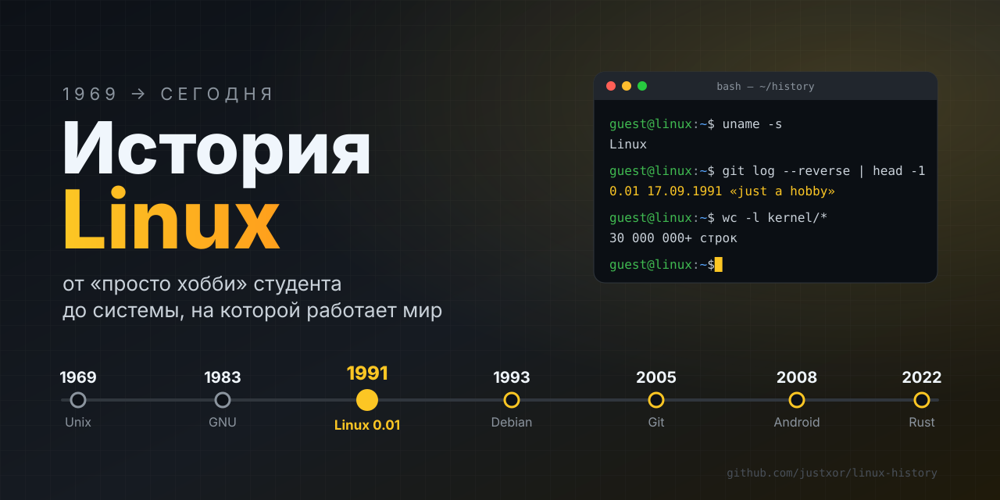

<br/>


**[🏛 Предыстория](#-предыстория-unix-и-gnu) • [🎂 Рождение](#-рождение-linux-1991) • [🕰 Хронология](#-хронология-развития) • [📜 Летопись](#-летопись-linux-история-в-14-главах) • [🌳 Дистрибутивы](#-генеалогическое-древо-дистрибутивов) • [🧩 Устройство](#-как-устроен-linux) • [🧪 Попробуй сам](#-попробуй-сам) • [🎯 Квиз](#-квиз-проверь-себя)**

</div>

---

> [!TIP]
> **Как читать этот README.** Всё, что начинается с ▶️, — кликабельно: раскрывай блоки, проходи квиз, а схемы можно увеличивать и двигать кнопками справа от них.

## 👋 Зачем знать историю Linux

Прямо сейчас, пока ты читаешь этот текст, Linux работает на сервере GitHub, который отдал тебе страницу, на роутере, через который идёт интернет, почти наверняка в твоём телефоне, а ещё — во всех пятистах самых мощных суперкомпьютерах планеты. Это самая распространённая операционная система в истории. И при этом её никто не «владеет»: ядро Linux бесплатно, открыто и создаётся тысячами людей из разных стран и компаний, которые часто конкурируют друг с другом.

Как так вышло? Как студенческий проект, начатый «просто ради интереса», обогнал продукты корпораций с миллиардными бюджетами? Ответ — в истории, и она куда интереснее, чем кажется. В ней есть:

- 🧑‍🔬 **гениальные одиночки** — инженеры Bell Labs, бунтарь из MIT и финский студент;
- ⚖️ **идеи, изменившие индустрию** — свободное ПО, лицензия GPL, «open source»;
- 💥 **конфликты и драмы** — споры о ядрах, войны рабочих столов, суды на миллиарды долларов, хакерские атаки;
- 🚀 **неожиданные повороты** — Linux в смартфонах, облаках, на Марсе и даже внутри Windows.

Знание этой истории помогает понять, **почему Linux устроен именно так**: откуда взялись «всё есть файл», права доступа, менеджеры пакетов, сотни дистрибутивов и культура открытой разработки. Команды перестают быть заклинаниями и становятся логичными.

> [!NOTE]
> **Для кого этот репозиторий:** для новичков, которые хотят разобраться, с чего всё началось; для тех, кто уже пользуется Linux и хочет понимать его глубже; и для всех, кто любит истории о технологиях. Никаких знаний программирования не нужно — всё объясняется простыми словами и схемами.

**Как устроен материал:** сначала — [предыстория](#-предыстория-unix-и-gnu) и [рождение Linux](#-рождение-linux-1991), затем [хронология](#-хронология-развития) и подробная [летопись в 14 главах](#-летопись-linux-история-в-14-главах). После истории — практика: [как устроена система](#-как-устроен-linux), [как выбрать дистрибутив](#-какой-дистрибутив-выбрать) и [команды, которые можно попробовать самому](#-попробуй-сам). А в конце — [квиз](#-квиз-проверь-себя), чтобы проверить себя.

## 📖 Содержание

<details open>
<summary><b>Показать / скрыть оглавление</b></summary>

1. [Зачем знать историю Linux](#-зачем-знать-историю-linux)
2. [Предыстория: Unix и GNU](#-предыстория-unix-и-gnu)
3. [Полезные ресурсы](#-полезные-ресурсы)
4. [Рождение Linux (1991)](#-рождение-linux-1991)
5. [Хронология развития](#-хронология-развития)
6. **[Летопись Linux: история в 14 главах](#-летопись-linux-история-в-14-главах)** ⭐
7. [Кто есть кто](#-кто-есть-кто)
8. [Как растёт ядро](#-как-растёт-ядро)
9. [Генеалогическое древо дистрибутивов](#-генеалогическое-древо-дистрибутивов)
10. [Какой дистрибутив выбрать: интерактивный тест](#-какой-дистрибутив-выбрать)
11. [Войны рабочих столов](#-войны-рабочих-столов)
12. [Как устроен Linux](#-как-устроен-linux)
13. [Как Linux загружается](#-как-linux-загружается)
14. [Жизнь процесса](#-жизнь-процесса)
15. [Как ядро разрабатывается сегодня](#-как-ядро-разрабатывается-сегодня)
16. [Где Linux сегодня](#-где-linux-сегодня)
17. [Linux, Windows, macOS: сравнение](#-linux-windows-macos)
18. [Попробуй сам](#-попробуй-сам)
19. [Интересные факты](#-интересные-факты)
20. [Квиз: проверь себя](#-квиз-проверь-себя)
21. [Чек-лист знатока](#-чек-лист-знатока)
22. [Что почитать и посмотреть](#-что-почитать-и-посмотреть)

</details>

---

## 🏛 Предыстория: Unix и GNU

Linux появился не на пустом месте. Он стоит на плечах двух гигантов — **Unix** и проекта **GNU**.

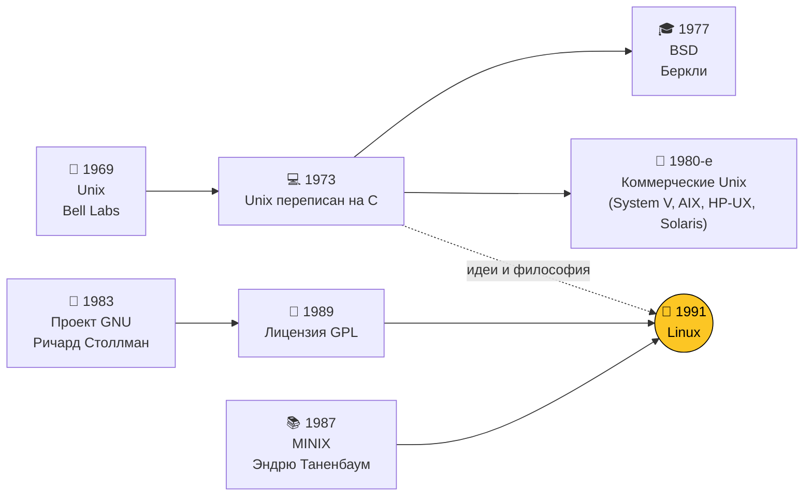

| Год | Событие | Почему это важно |
|:---:|---|---|
| **1969** | Кен Томпсон и Деннис Ритчи создают **Unix** в Bell Labs | Заложены принципы: «всё есть файл», маленькие утилиты, конвейеры |
| **1973** | Unix переписан на языке **C** | ОС впервые стала переносимой между разными компьютерами |
| **1977** | В Беркли появляется **BSD** | Свободная ветка Unix, предок FreeBSD и (частично) macOS |
| **1983** | Ричард Столлман объявляет проект **GNU** | Цель — полностью свободная Unix-подобная ОС |
| **1985** | Основан **Фонд свободного ПО (FSF)** | Юридическая и идейная опора свободного софта |
| **1987** | Эндрю Таненбаум выпускает **MINIX** | Учебная ОС, на которой учился и сам Линус |
| **1989** | Выходит **GNU GPL** | Лицензия «копилефт»: код остаётся свободным навсегда |

<details>
<summary>▶️ <b>Философия Unix в трёх правилах</b></summary>

<br/>

1. **Пиши программы, которые делают одну вещь, и делают её хорошо.**
2. **Пиши программы, которые работают вместе** — вывод одной становится вводом другой.
3. **Используй текст** как универсальный интерфейс.

Именно поэтому в Linux так любят конвейеры:

```bash
# 5 самых больших папок в домашнем каталоге
du -sh ~/* 2>/dev/null | sort -rh | head -5
```

Четыре маленькие программы, соединённые `|`, решают задачу, для которой ни одна из них не создавалась.

</details>

### 🔗 Полезные ресурсы

Хочешь не только читать историю, но и прокачаться в Linux на практике? Вот подборка Telegram-каналов:

| | Канал | Что там |
|:---:|---|---|
| 🖥 | **[Linux Academy](https://t.me/+xrbtU1Vgg245YjY6)** | Сложные концепции Linux простым языком: наглядные картинки, короткие видео и профессиональный подход к работе |
| ⚡️ | **[Kali Linux](https://t.me/+jnI7_NwRnd0zY2Yy)** | Авторский канал об этичном хакинге и защите информации с нуля |
| 🧠 | **[Machine Learning](https://t.me/+IikNImh3FuNmM2Ji)** | Практика с ИИ: генерация кода и баз данных, разбор всего важного в мире AI |
| 📚 | **[Linux Books](http://t.me/linux_read)** | Одна из крупнейших библиотек книг по Linux — около 320 книг бесплатно |

> [!TIP]
> 🔝 **[Вся подборка одной папкой](https://t.me/addlist/w4Doot-XBG4xNzYy)** — добавь сразу все полезные Linux-каналы в Telegram в один клик.

> [!NOTE]
> К 1991 году у GNU было почти всё — компилятор GCC, оболочка Bash, утилиты, — **кроме ядра**. Собственное ядро GNU Hurd так и не стало готовым. Эту дыру и закрыл Linux.

---

## 🎂 Рождение Linux (1991)

**25 августа 1991 года** 21-летний студент Хельсинкского университета **Линус Торвальдс** написал в новостную группу `comp.os.minix`, что делает свободную ОС для 386-х компьютеров —

> *«just a hobby, won't be big and professional like gnu»*

Скромнее начала не придумаешь 🙂

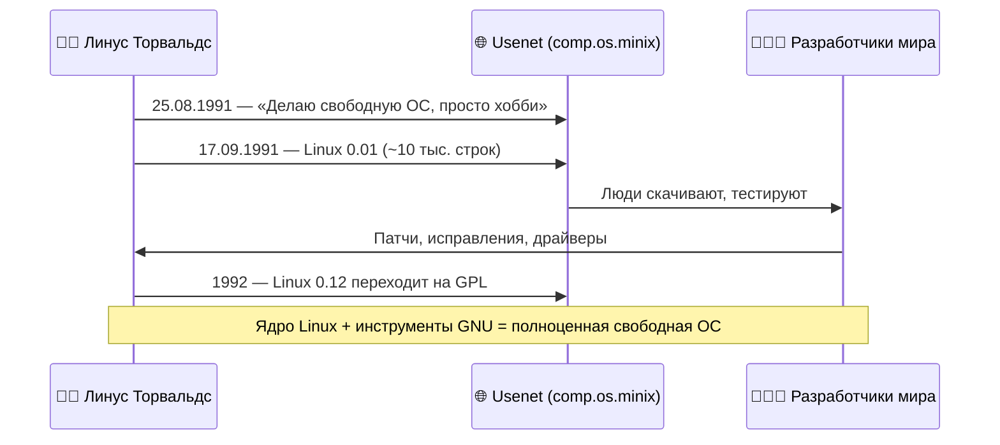

<details>
<summary>▶️ <b>Каким был компьютер Линуса в 1991 году?</b></summary>

<br/>

| Компонент | Тогда (1991) | Типичный ноутбук сегодня |
|---|---|---|
| Процессор | Intel 80386, 33 МГц | 8+ ядер, 3–5 ГГц |
| Память | 4 МБ | 16 ГБ — в **4000 раз** больше |
| Диск | ~40 МБ | 512 ГБ SSD |
| Цена | ~$3500 (купил в кредит) | — |

Linux 0.01 умел очень мало: работал только на 386-м, не поддерживал сеть, а для запуска нужен был установленный MINIX.

</details>

### ⚔️ Великий спор «Linux устарел» (1992)

В январе 1992 года Таненбаум опубликовал пост **«LINUX is obsolete»**: монолитное ядро — это шаг назад, будущее за **микроядрами**. Завязалась одна из самых известных дискуссий в истории ИТ.

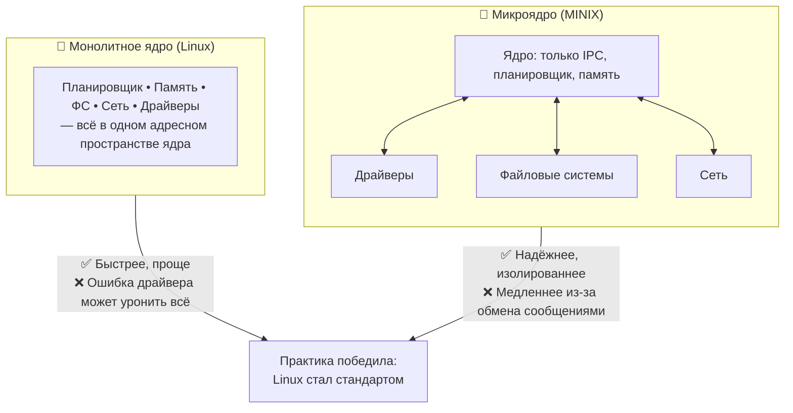

<details>
<summary>▶️ <b>А кто в итоге был прав?</b></summary>

<br/>

Оба — по-своему. Linux победил на практике: его проще было развивать, и он был быстрее на железе тех лет. Но идеи микроядер живут: на микроядре построены QNX (автомобили, промышленность) и seL4 (формально доказанное ядро), а MINIX 3 годами работал внутри Intel Management Engine — то есть, возможно, и в вашем процессоре.

</details>

> [!TIP]
> Современный Linux — монолитный, но **модульный**: драйверы можно загружать и выгружать на лету (`modprobe`, `lsmod`).

---

## 🕰 Хронология развития

### Часть 1. Становление (1991–2004)

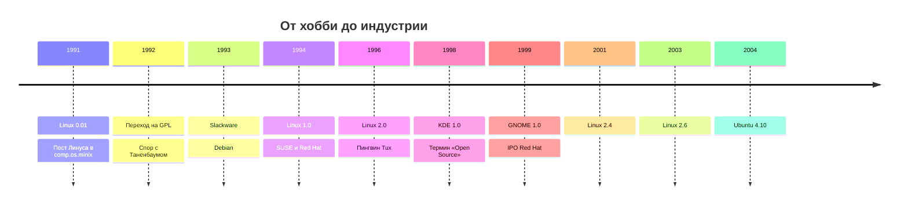

### Часть 2. Linux повсюду (2005–2022)

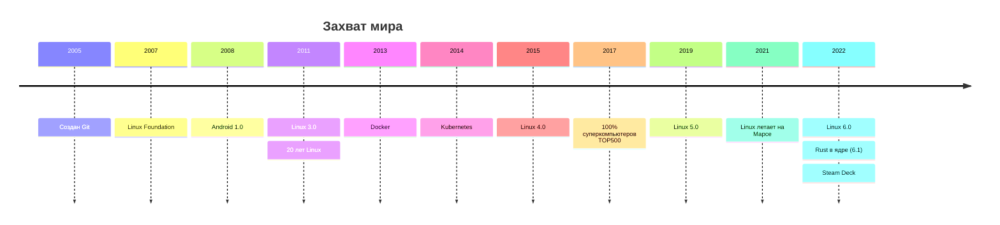

> [!TIP]
> Короткая версия — на схемах выше. Полная история — в **«Летописи»** ниже: 14 глав, которые читаются как книга.

---

## 📜 Летопись Linux: история в 14 главах

<details open>
<summary><b>📑 Оглавление летописи</b></summary>

| # | Глава | Годы |
|:---:|---|:---:|
| I | [Неудача, которая породила Unix](#глава-i-неудача-которая-породила-unix) | 1964–1984 |
| II | [Бунт из-за принтера: Столлман и GNU](#глава-ii-бунт-из-за-принтера-столлман-и-gnu) | 1980–1991 |
| III | [Студент, дедушкин компьютер и 386-й](#глава-iii-студент-дедушкин-компьютер-и-386-й) | 1969–1991 |
| IV | [Армия добровольцев и первые дистрибутивы](#глава-iv-армия-добровольцев-и-первые-дистрибутивы) | 1992–1993 |
| V | [Версия 1.0 и рождение бизнеса](#глава-v-версия-10-и-рождение-бизнеса) | 1994–1995 |
| VI | [Пингвин, Калифорния и слово «open source»](#глава-vi-пингвин-калифорния-и-слово-open-source) | 1996–1998 |
| VII | [Пузырь доткомов](#глава-vii-пузырь-доткомов) | 1999–2001 |
| VIII | [Миллиард от IBM и суд с SCO](#глава-viii-миллиард-от-ibm-и-суд-с-sco) | 2000–2007 |
| IX | [Ubuntu: Linux для людей](#глава-ix-ubuntu-linux-для-людей) | 2004 |
| X | [Git: программа, написанная от обиды](#глава-x-git-программа-написанная-от-обиды) | 2005 |
| XI | [Android: Linux в каждом кармане](#глава-xi-android-linux-в-каждом-кармане) | 2003–2012 |
| XII | [Облака, контейнеры и «Microsoft любит Linux»](#глава-xii-облака-контейнеры-и-microsoft-любит-linux) | 2006–2019 |
| XIII | [Кризисы взросления](#глава-xiii-кризисы-взросления) | 2011–2024 |
| XIV | [Rust, игры и будущее](#глава-xiv-rust-игры-и-будущее) | 2018–наши дни |

</details>

---

### Глава I. Неудача, которая породила Unix

<sub>📅 1964–1984 • 📍 Bell Labs, Нью-Джерси</sub>

В середине 1960-х MIT, General Electric и Bell Labs взялись за амбициозный проект **Multics** — операционную систему, которая должна была стать «компьютерной коммуналкой»: одна большая машина, сотни пользователей, как электричество из розетки. Проект оказался слишком сложным и слишком медленным, и в 1969 году Bell Labs из него вышла.

У инженера **Кена Томпсона** остались идеи Multics и желание играть в собственную игру **Space Travel** — симулятор полёта по Солнечной системе. В лаборатории нашёлся заброшенный мини-компьютер **PDP-7**, и летом 1969 года Томпсон за несколько недель написал для него простую ОС: ядро, оболочку, редактор и ассемблер. Коллеги в шутку назвали её **Unics** — «кастрированный Multics». Потом буква поменялась, и получился **Unix**.

Вторым отцом системы стал **Деннис Ритчи**. Он создал язык **C**, и в 1973 году Unix переписали на нём почти целиком. Это было революцией: раньше операционные системы писали на ассемблере конкретной машины, а теперь Unix можно было перенести на любой компьютер, для которого есть компилятор C.

Дальше вмешалась юриспруденция. По антимонопольному соглашению 1956 года компания AT&T (владелец Bell Labs) не имела права торговать компьютерами и программами. Поэтому Unix почти даром раздавали университетам — вместе с исходным кодом. Целое поколение студентов выросло, читая код Unix; ходили по рукам ксерокопии «Комментариев Лайонса» — книги австралийского профессора, разбиравшего ядро строчка за строчкой.

В Калифорнийском университете в Беркли на основе Unix сделали свою версию — **BSD**. Именно в BSD появился стек TCP/IP, на котором работает интернет.

Идиллия кончилась в 1984-м: AT&T разделили, запрет на торговлю сняли, и Unix превратился в дорогой закрытый продукт. Начались «войны Unix» — десятки несовместимых коммерческих версий от IBM, HP, Sun и других. Исходники больше нельзя было показывать студентам. И как раз в это время один человек в MIT решил, что так быть не должно.

> 💬 **Главное:** Unix подарил миру идеи (файлы, процессы, конвейеры, переносимость на C), но к середине 80-х стал закрытым и дорогим. Возникла потребность в свободной альтернативе.

---

### Глава II. Бунт из-за принтера: Столлман и GNU

<sub>📅 1980–1991 • 📍 MIT, Кембридж (Массачусетс)</sub>

**Ричард Столлман** работал программистом в лаборатории искусственного интеллекта MIT, где программы было принято свободно передавать и улучшать. Легенда гласит, что всё началось с принтера: лаборатории подарили новый лазерный принтер Xerox, который постоянно заминало. На старом принтере Столлман сам дописал в драйвер уведомления о замятии бумаги, но код нового драйвера Xerox не дала — его закрыли соглашением о неразглашении. Мелочь, но Столлман увидел в ней большую проблему: пользователь больше не хозяин своего компьютера.

27 сентября 1983 года он объявил о создании **GNU** — полностью свободной Unix-совместимой системы. Название — рекурсивная шутка программистов: **G**NU's **N**ot **U**nix («GNU — не Unix»). В 1984-м Столлман уволился из MIT, чтобы университет не мог претендовать на его код, а в 1985-м основал **Фонд свободного ПО (FSF)**.

За несколько лет проект GNU создал огромное количество программ: редактор **Emacs**, компилятор **GCC** (1987), отладчик GDB, оболочку **Bash**, утилиты `ls`, `cp`, `grep` и сотни других. Самым важным изобретением, впрочем, стал не код, а юридический текст — лицензия **GNU GPL** (1989). Её идея — **копилефт**: бери, изучай, меняй и распространяй сколько хочешь, но если распространяешь изменённую версию — обязан открыть её код на тех же условиях. Свободу нельзя «приватизировать».

Оставалась одна проблема — **ядро**. Столлман выбрал для ядра GNU **Hurd** амбициозную микроядерную архитектуру поверх Mach. Она оказалась очень сложной в разработке, и к 1991 году готовой версии не было. У GNU было всё — кроме сердца системы.

> 💬 **Главное:** к 1991 году существовал почти полный набор свободных программ и лицензия, защищающая их свободу. Не хватало только ядра.

---

### Глава III. Студент, дедушкин компьютер и 386-й

<sub>📅 1969–1991 • 📍 Хельсинки, Финляндия</sub>

**Линус Бенедикт Торвальдс** родился 28 декабря 1969 года в Хельсинки, в семье журналистов, принадлежащей к шведскоязычному меньшинству Финляндии. Первым его компьютером стал **Commodore VIC-20** дедушки, профессора статистики: мальчик помогал ему вводить программы и быстро начал писать свои — сначала на BASIC, потом прямо в машинных кодах. Позже он купил **Sinclair QL** и переписывал на нём всё, что не нравилось, включая части операционной системы.

В 1990 году, студентом Хельсинкского университета, Линус прошёл курс по Unix и влюбился в эту систему. 5 января 1991 года он купил в кредит компьютер на процессоре **Intel 80386** и установил на него **MINIX** — учебную ОС профессора Таненбаума. MINIX нравился ему, но раздражал: в нём были урезаны возможности, а менять код по лицензии было нельзя.

Сначала Линус написал простую программу — **эмулятор терминала**, чтобы подключаться к университетскому компьютеру и читать новости Usenet. Программа работала напрямую с железом, без MINIX. Потом ему понадобилось скачивать файлы — он добавил драйвер диска. Потом файловую систему. В какой-то момент он понял, что пишет уже не программу, а **операционную систему**.

Был и драматический момент: однажды Линус случайно стёр раздел диска с MINIX. Вместо того чтобы переустанавливать, он решил, что его собственная система должна научиться обходиться без MINIX сама.

25 августа 1991 года он написал в группу `comp.os.minix` знаменитое сообщение: делаю свободную ОС, «просто хобби», ничего большого и профессионального, как GNU. В сентябре администратор финского FTP-сервера **Ари Лемке** выделил ему папку. Линус хотел назвать систему **Freax**, но Лемке это название не понравилось, и он назвал папку `linux`. 17 сентября 1991 года там появилась **версия 0.01** — около 10 тысяч строк кода. 5 октября вышла версия 0.02, и Линус пригласил всех желающих присоединиться.

> 💬 **Главное:** Linux начался как личный проект студента, который хотел понять, как работает его новый компьютер.

---

### Глава IV. Армия добровольцев и первые дистрибутивы

<sub>📅 1992–1993 • 📍 Интернет</sub>

Изначально у Linux была собственная лицензия Линуса: код открыт, но **продавать нельзя**. Очень быстро выяснилось, что это мешает — люди хотели продавать дискеты с системой хотя бы по цене носителей. В начале 1992 года, с версии **0.12**, Линус перевёл ядро на **GNU GPL**. Позже он назовёт это решение лучшим из всех, что он принял: GPL гарантировала, что все улучшения возвращаются в общий котёл.

29 января 1992 года профессор Таненбаум опубликовал пост **«LINUX is obsolete»**: монолитное ядро — пережиток 70-х, привязка к процессору 386 — ошибка. Линус резко ответил, завязался спор, в котором участвовали десятки людей. Спор стал легендой, но на развитие Linux никак не повлиял — разработчиков становилось всё больше.

В марте 1992 года вышла версия **0.95**: на Linux заработала графическая система **X Window**. Номер версии подскочил, потому что Линус думал, что до 1.0 осталось чуть-чуть. Он ошибся: дорога заняла ещё два года и растянулась в длинную серию версий 0.99 с буквенными индексами.

Установить ранний Linux было непросто: нужно было отдельно скачать ядро, утилиты GNU, собрать всё вместе на нескольких дискетах. Так появились **дистрибутивы** — готовые наборы «всё в одном»:

- **MCC Interim Linux** (февраль 1992) — Манчестерский компьютерный центр;
- **SLS** (1992) — первый «полный» дистрибутив с X Window, но с множеством ошибок;
- **Slackware** (июль 1993) — Патрик Фолькердинг исправил ошибки SLS и сделал свой дистрибутив. Slackware жив до сих пор — это старейший из действующих дистрибутивов;
- **Debian** (16 августа 1993) — Иэн Мёрдок тоже был недоволен SLS. Он опубликовал «Манифест Debian»: дистрибутив должны делать открыто, всем сообществом, как само ядро. Позже появился «Общественный договор Debian» — свод принципов свободного ПО.

> 💬 **Главное:** GPL и интернет превратили личный проект в общее дело тысяч людей, а дистрибутивы сделали Linux доступным не только хакерам.

---

### Глава V. Версия 1.0 и рождение бизнеса

<sub>📅 1994–1995 • 📍 Хельсинки, Северная Каролина, Нюрнберг</sub>

14 марта 1994 года в актовом зале Хельсинкского университета торжественно выпустили **Linux 1.0** — около 176 тысяч строк кода, с поддержкой сети. Система, которую ещё недавно называли «студенческой игрушкой», стала пригодной для реальной работы.

В том же году вокруг Linux начал формироваться бизнес:

- **Red Hat.** Программист Марк Юинг собирал свой дистрибутив и носил красную кепку деда, в которой ходил по университету Корнелла, — так появилось название. Предприниматель Боб Янг продавал книги и диски о Linux по каталогу. В 1995 году они объединились в **Red Hat Software** и построили бизнес не на продаже кода (он бесплатен), а на поддержке и обслуживании.
- **SUSE.** В 1992 году в Германии четверо студентов основали компанию, которая сначала переводила Slackware на немецкий, а в 1994-м выпустила собственный **S.u.S.E. Linux**. Она стала главным дистрибутивом Европы.

В 1995 году вышел **Linux 1.2** с поддержкой процессоров помимо x86 — Alpha, SPARC, MIPS. Linux перестал быть «системой для 386-го».

Тогда же случилась странная история с **товарным знаком**. Некий бостонский бизнесмен, не имевший к Linux никакого отношения, в 1994 году зарегистрировал в США торговую марку «Linux» и начал требовать отчислений с компаний. Сообщество подало в суд, и в 1997 году марку передали Линусу. С тех пор ей управляет специальная некоммерческая организация.

> 💬 **Главное:** Linux стал «взрослым» (1.0), и появились компании, доказавшие, что на бесплатном коде можно строить бизнес.

---

### Глава VI. Пингвин, Калифорния и слово «open source»

<sub>📅 1996–1998 • 📍 Санта-Клара (Калифорния), весь мир</sub>

В июне 1996 года вышел **Linux 2.0**: он умел работать на компьютерах с **несколькими процессорами** (SMP) — это открыло дорогу на серверы. Тогда же сообщество выбирало талисман. Предлагали орлов, акул и лис, но Линус хотел пингвина — он вспоминал, как в австралийском зоопарке его клюнул маленький пингвин. Программист **Ларри Юинг** нарисовал довольного упитанного пингвина в редакторе GIMP (тоже свободной программе), и **Tux** стал символом Linux.

В 1997 году Линус переехал из Финляндии в Калифорнию, в Кремниевую долину: он получил работу в загадочной стартап-компании **Transmeta**, которая разрабатывала энергоэффективные процессоры. Условие было одно — ему разрешили продолжать работу над Linux.

В январе 1998 года компания **Netscape**, проигрывавшая Microsoft «войну браузеров», объявила, что откроет исходный код своего браузера (из него позже вырастет Firefox). Для бизнеса это был шок. Сторонники свободного ПО поняли: слово «free» пугает корпорации (по-английски оно означает и «свободный», и «бесплатный»). В феврале 1998 года **Кристин Петерсон** предложила термин **«open source»** — «открытый исходный код». Вскоре Эрик Рэймонд и Брюс Перенс основали **Open Source Initiative**. Столлман этот термин не принял, считая, что он затушёвывает главное — свободу. Так возникли два лагеря, спорящие до сих пор.

Осенью 1998 года произошла утечка **«Хэллоуинских документов»** — внутренних записок Microsoft, где Linux и open source назывались серьёзной угрозой и обсуждались способы борьбы с ними. Для сообщества это стало лучшим комплиментом: гигант их заметил. В том же году Oracle, IBM, Informix и другие крупные компании объявили о поддержке Linux.

> 💬 **Главное:** Linux получил талисман, прописку в Кремниевой долине и новое «деловое» имя — open source. Большой бизнес начал воспринимать его всерьёз.

---

### Глава VII. Пузырь доткомов

<sub>📅 1999–2001 • 📍 Уолл-стрит</sub>

Конец 90-х — время безумного интернет-бума. 11 августа 1999 года **Red Hat** вышла на биржу, и её акции в первый же день выросли почти втрое. Компания выделила часть акций для разработчиков ядра — многие добровольцы неожиданно стали обладателями ценных бумаг.

В декабре 1999 года на биржу вышла **VA Linux**, продававшая серверы с Linux. Её акции за первый день выросли примерно на **700%** — рекорд для IPO того времени.

Параллельно развивался десктоп. В 1996 году немецкий студент Маттиас Эттрих основал проект **KDE** — красивый рабочий стол для Linux. Но KDE использовал библиотеку **Qt**, которая тогда не была полностью свободной. В ответ в 1997 году **Мигель де Икаса** и Федерико Мена запустили **GNOME**. Так началась «война рабочих столов», которая подстегнула оба проекта. KDE 1.0 вышел в 1998-м, GNOME 1.0 — в 1999-м.

В 2000 году пузырь доткомов лопнул. Акции VA Linux обрушились, многие Linux-компании разорились. Но сам Linux не пострадал: код никуда не делся, а серверы на нём продолжали работать. В январе 2001 года вышел **Linux 2.4** с поддержкой USB, большого объёма памяти и улучшенной сетью — система была готова к корпоративному миру.

> 💬 **Главное:** биржевая лихорадка прошла, но показала, что Linux — это деньги. Компании, пережившие крах, стали фундаментом Linux-индустрии.

---

### Глава VIII. Миллиард от IBM и суд с SCO

<sub>📅 2000–2007 • 📍 Армонк (Нью-Йорк), Юта</sub>

В декабре 2000 года **IBM** объявила, что вложит в Linux **миллиард долларов** за 2001 год. Компания перенесла Linux на все свои платформы — от небольших серверов до мейнфреймов — и выделила сотни инженеров для работы над ядром. Это был сигнал всему рынку: Linux — серьёзная корпоративная платформа.

Microsoft отреагировала жёстко. В 2001 году её глава **Стив Балмер** назвал Linux «раковой опухолью» из-за GPL, которая «прилипает» ко всему, к чему прикасается.

Но самая большая угроза пришла с неожиданной стороны. В марте 2003 года компания **SCO Group**, купившая права на часть наследия Unix, подала в суд на IBM, требуя сначала миллиард, а потом пять миллиардов долларов. SCO утверждала, что в Linux незаконно скопирован код Unix, и начала рассылать компаниям требования покупать «лицензии на Linux». Над всем сообществом повис вопрос: а законен ли вообще Linux?

Сообщество ответило методично: сверяло код, искало происхождение каждой спорной строчки. Ключевой удар нанесла **Novell**: она заявила, что права на Unix остались у неё. В 2007 году суд с этим согласился, и SCO в том же году обанкротилась. Обвинения в краже кода так и не подтвердились, и Linux вышел из этой истории юридически чище, чем был: его происхождение стало, пожалуй, самым проверенным в мире софта.

Пока шли суды, ядро развивалось: в декабре 2003 года вышел **Linux 2.6** — с новым планировщиком, улучшенной поддержкой многопроцессорных систем и встраиваемых устройств. В 2003 году Линус ушёл из Transmeta и стал работать в консорциуме **OSDL**, который платил ему за то, чтобы он занимался только ядром. В 2007 году OSDL объединилась с Free Standards Group, и появилась **The Linux Foundation**.

> 💬 **Главное:** большие корпорации встали на сторону Linux, а попытка «засудить» его закончилась провалом нападавших.

---

### Глава IX. Ubuntu: Linux для людей

<sub>📅 2004 • 📍 Кейптаун и Лондон</sub>

К началу 2000-х Linux был прекрасен на серверах, но для обычного человека оставался сложным: установка требовала знаний, а настройка звука или Wi-Fi могла занять вечер.

Ситуацию изменил южноафриканский предприниматель **Марк Шаттлворт**. В 1999 году он продал свою компанию Thawte (цифровые сертификаты для интернета) за сотни миллионов долларов, а в 2002-м стал вторым в истории космическим туристом, слетав на МКС. Затем он основал компанию **Canonical** и собрал команду разработчиков Debian.

20 октября 2004 года вышла первая версия **Ubuntu 4.10** с кодовым именем *Warty Warthog* («Бородавчатый бородавочник»). «Ubuntu» — слово из языков зулу и коса, приблизительно означающее «человечность по отношению к другим».

Идеи Ubuntu были простыми, но для Linux революционными:

- **новая версия строго каждые полгода** (номер — это год и месяц: 4.10 = 2004, октябрь);
- **один компакт-диск**, который можно запустить без установки (Live CD);
- **бесплатная доставка дисков** почтой в любую точку мира через сервис ShipIt;
- версии **LTS** с долгой поддержкой для компаний.

Ubuntu быстро стал самым популярным десктопным дистрибутивом, а на его основе появились Linux Mint, elementary OS, Pop!_OS и многие другие.

> 💬 **Главное:** Ubuntu показал, что Linux может быть простым и дружелюбным, и привёл в мир Linux миллионы обычных пользователей.

---

### Глава X. Git: программа, написанная от обиды

<sub>📅 2005 • 📍 Портленд (Орегон)</sub>

Долгое время Линус принимал изменения в ядро по почте и вручную. К началу 2000-х это стало невыносимо. В 2002 году он начал пользоваться **BitKeeper** — коммерческой системой контроля версий, которую её владелец разрешил использовать бесплатно для разработки ядра. Многие (особенно Столлман) возмущались: как свободное ядро может зависеть от закрытой программы?

Проблема решилась сама собой, причём драматично. В 2005 году австралийский программист **Эндрю Триджелл** (автор Samba) начал разбирать сетевой протокол BitKeeper, чтобы сделать свободный клиент. Владелец BitKeeper счёл это нарушением и **отозвал бесплатную лицензию** у всего сообщества.

Ядро осталось без инструмента. Линус оценил существующие альтернативы, посчитал их слишком медленными и в начале апреля 2005 года сел писать **свою систему**. Через несколько дней Git уже хранил собственный исходный код, а к июню на нём вышла версия ядра. Линус назвал программу «git» — на британском сленге это «неприятный тип», пошутив, что всё называет в честь себя: сначала Linux, теперь Git.

Летом 2005 года Линус передал поддержку Git японскому программисту **Дзюнио Хамано**, который руководит проектом до сих пор. В 2008 году появился **GitHub** — сервис, на котором ты сейчас читаешь этот текст. Сегодня Git использует подавляющее большинство разработчиков на планете.

> 💬 **Главное:** вторая великая программа Торвальдса появилась из-за конфликта лицензий и меньше чем за год изменила всю индустрию разработки.

---

### Глава XI. Android: Linux в каждом кармане

<sub>📅 2003–2012 • 📍 Пало-Альто, Маунтин-Вью</sub>

В 2003 году **Энди Рубин** с партнёрами основал стартап **Android Inc.** Изначально его хотели делать системой для цифровых фотоаппаратов, но быстро переключились на телефоны. В 2005 году стартап тихо купила **Google**.

Для своей системы Android выбрал **ядро Linux** — проверенное, бесплатное и поддерживающее массу железа. Поверх него Google построила собственный мир: свою библиотеку C (Bionic), виртуальную машину для Java-приложений и интерфейс. Утилит GNU в Android почти нет, поэтому его часто приводят как пример «Linux без GNU».

В октябре 2008 года вышел первый смартфон на Android — **HTC Dream** (T-Mobile G1) с выдвижной клавиатурой. Через несколько лет Android стал самой популярной операционной системой в мире.

С сообществом ядра отношения складывались непросто. Google внесла в ядро собственные изменения (например, механизм «wakelocks» для экономии батареи), которые разработчики основного ядра сначала отказались принять. В 2009 году код Android даже **удалили** из основного дерева. Компромисс искали несколько лет, и к 2012 году большая часть изменений Android вернулась в основное ядро.

> 💬 **Главное:** благодаря Android ядро Linux оказалось в миллиардах устройств — больше, чем любая другая ОС в истории.

---

### Глава XII. Облака, контейнеры и «Microsoft любит Linux»

<sub>📅 2006–2019 • 📍 Сиэтл, Маунтин-Вью, Сан-Франциско</sub>

В 2006 году Amazon запустила **EC2** — сервис, где виртуальный сервер можно арендовать на час. Под капотом работал Linux. Так началась эпоха **облаков**, и Linux стал их естественной основой: бесплатный (не нужно платить за лицензию каждой виртуальной машины), гибкий и надёжный.

Ядро быстро обросло инструментами для облаков:

- **KVM** (2007) — встроенная в ядро виртуализация: Linux сам превращается в гипервизор;
- **cgroups** (2008) — механизм ограничения ресурсов, разработанный инженерами Google;
- **namespaces** — «пространства имён», позволяющие процессу видеть свой собственный мир: свою сеть, свои файлы, свои PID.

Из cgroups и namespaces в 2013 году родился **Docker**: он упаковал эти сложные механизмы в простую команду `docker run`. В 2014 году Google открыла **Kubernetes** — систему управления тысячами контейнеров, наследницу своей внутренней системы Borg. Сегодня большая часть интернета работает в контейнерах на ядре Linux.

А потом случилось то, во что в 2001 году никто бы не поверил. В 2014 году новый глава Microsoft **Сатья Наделла** вышел на сцену со слайдом **«Microsoft ❤️ Linux»**. В облаке Azure Linux быстро стал популярнее Windows. В 2016 году Microsoft вошла в Linux Foundation на самом высоком уровне членства и выпустила **WSL** — возможность запускать Linux-программы прямо в Windows. Во второй версии WSL внутри Windows работает настоящее ядро Linux.

> 💬 **Главное:** облака сделали Linux основой интернета, а бывший главный противник стал одним из крупнейших участников разработки.

---

### Глава XIII. Кризисы взросления

<sub>📅 2011–2024 • 📍 Весь мир</sub>

Огромный успех принёс огромную ответственность — и несколько серьёзных испытаний.

**2011 — взлом kernel.org.** Злоумышленники проникли на главный сервер ядра. Код не пострадал: благодаря Git каждая версия защищена криптографическими хешами, и подделку обнаружили бы тысячи копий у разработчиков. Но после этого случая разработчики перешли на подписи ключами и строгие проверки.

**2018 — Meltdown и Spectre.** Обнаружились уязвимости не в программах, а в самих процессорах. Разработчикам ядра пришлось срочно, в условиях секретности, переделывать фундаментальные механизмы работы с памятью.

**2018 — Линус берёт паузу.** Линус много лет славился резкими, порой грубыми письмами в рассылке. В сентябре 2018 года он публично извинился, признал, что его поведение отталкивало людей, и ушёл в короткий отпуск, чтобы поработать над собой. Проект принял **Кодекс поведения** (Code of Conduct). Через месяц Линус вернулся.

**2021 — «гипокритические коммиты».** Исследователи Университета Миннесоты намеренно отправляли в ядро патчи со скрытыми уязвимостями, чтобы проверить, заметят ли их. Сообщество возмутилось экспериментом над людьми без их согласия и **запретило** университету отправлять код в ядро.

**2024 — бэкдор в XZ.** Самая детективная история. Несколько лет некто под именем «Jia Tan» терпеливо помогал развивать маленькую, но вездесущую библиотеку сжатия **XZ Utils**, вошёл в доверие и стал её соразработчиком. В 2024 году он спрятал в неё хитрый бэкдор, который мог открыть доступ к серверам через SSH. Бэкдор успел попасть в тестовые версии дистрибутивов. Его случайно обнаружил инженер **Андрес Фройнд**: он заметил, что вход по SSH стал медленнее примерно на полсекунды, и начал разбираться.

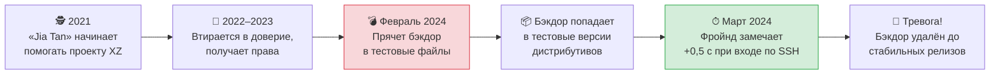

> 💬 **Главное:** открытый код не делает систему неуязвимой, но позволяет тысячам глаз находить проблемы. Каждый кризис делал процесс разработки строже.

---

### Глава XIV. Rust, игры и будущее

<sub>📅 2018–наши дни • 📍 Весь мир</sub>

**Rust в ядре.** Около двух третей серьёзных уязвимостей в ядре связаны с ошибками работы с памятью — классической слабостью языка C. Язык **Rust** спроектирован так, чтобы такие ошибки ловились ещё при компиляции. Проект **Rust for Linux** под руководством Мигеля Охеды добился исторического решения: в декабре 2022 года, в версии **6.1**, ядро впервые за 30 лет приняло второй язык программирования. Путь не был гладким — между сторонниками C и Rust шли жаркие споры, а несколько ключевых разработчиков Rust-части ушли из проекта, устав от конфликтов. Тем не менее на Rust пишут всё больше драйверов, и к середине 2020-х Rust в ядре перестал считаться экспериментом.

**Игры.** Долгое время главный аргумент против Linux на десктопе звучал так: «на нём нет игр». Компания **Valve** взялась это изменить. В 2018 году она выпустила **Proton** — слой совместимости на основе Wine, позволяющий запускать Windows-игры из Steam на Linux. В 2022 году вышла портативная консоль **Steam Deck** на SteamOS (основанной на Arch Linux). Миллионы людей стали пользоваться Linux, часто даже не подозревая об этом.

**Будущее.** Ядро Linux сегодня — это свыше 30 миллионов строк кода, новая версия каждые 9–10 недель и тысячи разработчиков из сотен компаний в каждом релизе. Главный вызов теперь не технический, а человеческий: многие ключевые мейнтейнеры работают над ядром десятилетиями, и проекту нужно растить новое поколение. Сам Линус, которому уже за пятьдесят, давно говорит о том, что Linux должен пережить своего создателя — и вся структура проекта с доверенными мейнтейнерами подсистем выстроена именно так.

> 💬 **Главное:** через 35 лет после «просто хобби» Linux работает везде — от Марса до часов на руке, — и продолжает меняться.

---

<div align="center">

**🐧 Конец летописи. Но не конец истории — она пишется прямо сейчас, в рассылке LKML.**

</div>

---

## 👥 Кто есть кто

<table>
<tr>
<td align="center" width="25%">
<h3>👨‍💻</h3>
<b>Линус Торвальдс</b><br/>
<sub>Финляндия, р. 1969</sub>
</td>
<td align="center" width="25%">
<h3>🗽</h3>
<b>Ричард Столлман</b><br/>
<sub>США, р. 1953</sub>
</td>
<td align="center" width="25%">
<h3>📚</h3>
<b>Эндрю Таненбаум</b><br/>
<sub>Нидерланды, р. 1944</sub>
</td>
<td align="center" width="25%">
<h3>🌀</h3>
<b>Иэн Мёрдок</b><br/>
<sub>США, 1973–2015</sub>
</td>
</tr>
</table>

<details>
<summary>▶️ <b>Линус Торвальдс</b> — создатель ядра и Git</summary>

<br/>

Начал Linux студентом в 21 год. До сих пор принимает финальные решения о том, что попадёт в ядро. Знаменит прямотой — и тем, что в 2018 году публично извинился за резкий стиль общения и взял паузу, чтобы его поменять. Назван в честь Лайнуса Полинга, лауреата двух Нобелевских премий.

</details>

<details>
<summary>▶️ <b>Ричард Столлман</b> — отец свободного ПО</summary>

<br/>

Основал проект GNU и FSF, придумал GPL. Сформулировал «четыре свободы»: запускать, изучать, распространять и изменять программы. Именно GPL заставила компании, улучшающие Linux, возвращать свои изменения сообществу.

</details>

<details>
<summary>▶️ <b>Эндрю Таненбаум</b> — автор MINIX</summary>

<br/>

Профессор из Амстердама, автор классических учебников по ОС и сетям. Его MINIX вдохновил Линуса, а спор о микроядрах стал легендой. Позднее он сам признавал, что спор был скорее академическим.

</details>

<details>
<summary>▶️ <b>Иэн Мёрдок</b> — основатель Debian</summary>

<br/>

Создал Debian в 1993 году. Название — сочетание имён его тогдашней девушки **Деб**ры и его самого (**Ian**). Debian стал основой для Ubuntu, Mint и сотен других дистрибутивов.

</details>

---

## 📈 Как растёт ядро

Примерное количество строк исходного кода в ядре:

| Версия | Год | Строк кода (≈) | Масштаб |
|:---:|:---:|---:|---|
| 0.01 | 1991 | 10 тыс. | ▏ |
| 1.0 | 1994 | 176 тыс. | ▍ |
| 2.0 | 1996 | 780 тыс. | █ |
| 2.4 | 2001 | 3,4 млн | ███▌ |
| 2.6.0 | 2003 | 5,9 млн | ██████ |
| 3.0 | 2011 | 14,6 млн | ██████████████▌ |
| 4.0 | 2015 | 19,5 млн | ███████████████████▌ |
| 5.0 | 2019 | 26 млн | ██████████████████████████ |
| 6.x | 2022+ | 30+ млн | ██████████████████████████████+ |

Из чего состоит этот код (очень приблизительно):

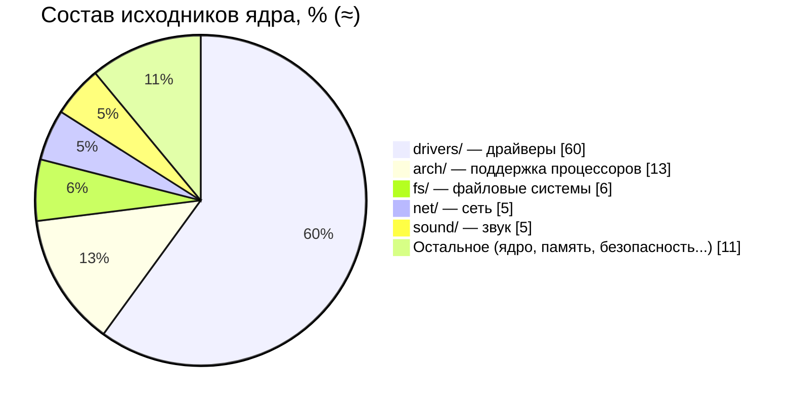

> [!NOTE]
> Больше половины ядра — **драйверы** устройств. Ядро, собранное под конкретный компьютер, использует лишь малую часть.

<details>
<summary>▶️ <b>Как читать номер версии ядра?</b></summary>

<br/>

```text
   6 . 8 . 12 - 300 - generic
   │   │   │     │       └─ вариант сборки от дистрибутива
   │   │   │     └───────── номер сборки дистрибутива
   │   │   └─────────────── патч-версия (исправления, стабильная ветка)
   │   └─────────────────── основная версия (выходит каждые ~9–10 недель)
   └─────────────────────── «большой» номер (меняется, когда Линусу так захочется)
```

До 2.6 существовало правило: чётные минорные номера (2.**4**, 2.**6**) — стабильные, нечётные (2.**5**) — экспериментальные. Сейчас его нет.

</details>

---

## 🌳 Генеалогическое древо дистрибутивов

Дистрибутив = **ядро Linux** + утилиты GNU + менеджер пакетов + программы + оформление.

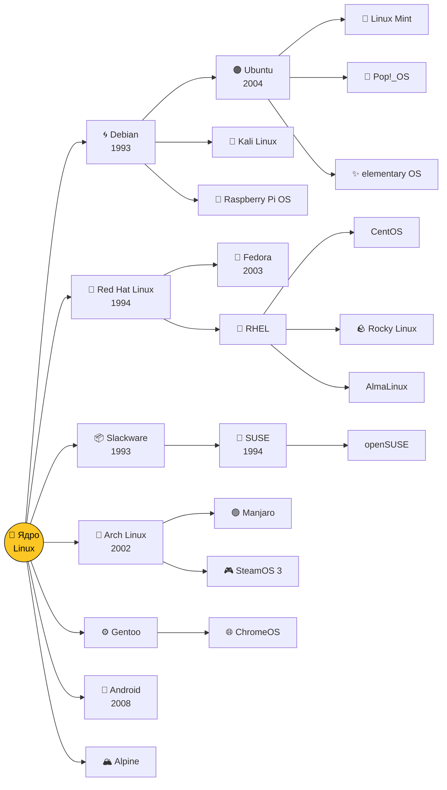

### 🗺 Карта дистрибутивов: сложность и свежесть

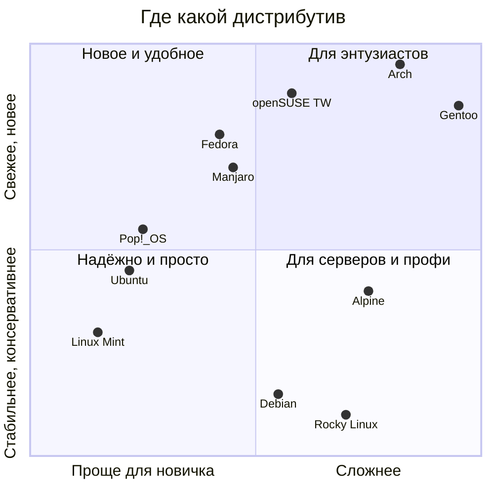

| Семейство | Пакеты | Характер | Для кого |
|---|---|---|---|
| **Debian / Ubuntu** | `.deb`, `apt` | Стабильный, огромное сообщество | Новички, серверы, разработчики |
| **Red Hat / Fedora** | `.rpm`, `dnf` | Корпоративный стандарт, свежие технологии | Компании, DevOps |
| **Arch** | `pacman`, AUR | «Собери сам», всегда самое новое | Энтузиасты, любители настройки |
| **SUSE** | `.rpm`, `zypper` | Удобный конфигуратор YaST | Европейский enterprise |
| **Alpine** | `apk` | Крошечный (несколько МБ) | Docker-контейнеры |

---

## 🧭 Какой дистрибутив выбрать?

Пройди тест — ответь на вопросы, раскрывая блоки:


<details>
<summary>▶️ <b>Вопрос 1: Ты раньше пользовался Linux?</b></summary>

<br/>

<details>
<summary>👉 <b>Нет, впервые</b></summary>

<br/>

<details>
<summary>🪟 <b>Я привык к Windows</b></summary>

> 🎉 **Твой выбор — Linux Mint (Cinnamon).** Меню «Пуск», панель задач, всё на привычных местах. Работает даже на старом ноутбуке.

</details>

<details>
<summary>🍏 <b>Мне нравится стиль macOS</b></summary>

> 🎉 **Твой выбор — elementary OS** (или **Ubuntu** с GNOME). Аккуратный минималистичный интерфейс с док-панелью.

</details>

</details>

<details>
<summary>👉 <b>Да, уже пробовал</b></summary>

<br/>

<details>
<summary>🔧 <b>Хочу собрать систему под себя</b></summary>

> 🎉 **Твой выбор — Arch Linux.** Ставишь только то, что нужно, а [Arch Wiki](https://wiki.archlinux.org) — лучшая документация по Linux вообще. Хардкор? Тогда **Gentoo**.

</details>

<details>
<summary>💼 <b>Нужна рабочая машина для разработки</b></summary>

> 🎉 **Твой выбор — Fedora Workstation.** Свежие версии софта, чистый GNOME, отличная поддержка железа.

</details>

<details>
<summary>🎮 <b>Хочу играть</b></summary>

> 🎉 **Твой выбор — Pop!_OS или Bazzite.** Драйверы NVIDIA из коробки, Steam + Proton запускают большинство игр с Windows.

</details>

<details>
<summary>🖥 <b>Поднимаю сервер</b></summary>

> 🎉 **Твой выбор — Debian** (надёжность годами) или **Rocky Linux / AlmaLinux** (совместимость с RHEL).

</details>

</details>

</details>

> [!TIP]
> Не обязательно устанавливать: любой дистрибутив можно запустить с флешки в режиме **Live USB** или в виртуальной машине (VirtualBox) и просто посмотреть.

---

## 🖼 Войны рабочих столов

В Linux графический интерфейс — это просто программа, и её можно заменить. Поэтому интерфейсов много.

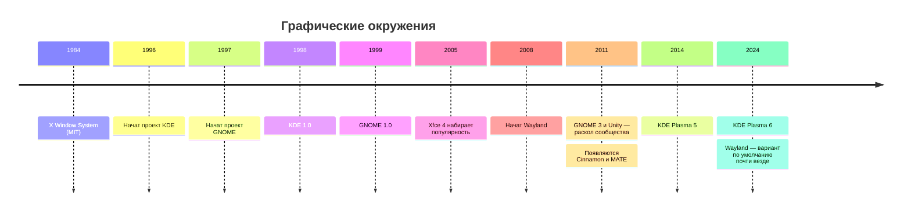

<details>
<summary>▶️ <b>Почему KDE и GNOME вообще соперничают?</b></summary>

<br/>

KDE был построен на библиотеке **Qt**, лицензия которой в 1990-х не была полностью свободной. Сторонники свободного ПО обеспокоились и запустили **GNOME** на свободной библиотеке GTK. Позже Qt стала свободной, но два лагеря остались — и это пошло на пользу: конкуренция двигает оба проекта вперёд.

| | GNOME | KDE Plasma | Xfce |
|---|---|---|---|
| Философия | Минимализм, «всё продумано за вас» | Настраивается абсолютно всё | Лёгкий и быстрый |
| Похож на | macOS / планшет | Windows на стероидах | Классический рабочий стол |
| Ресурсы | Средние | Средние | Минимальные |

</details>

---

## 🧩 Как устроен Linux

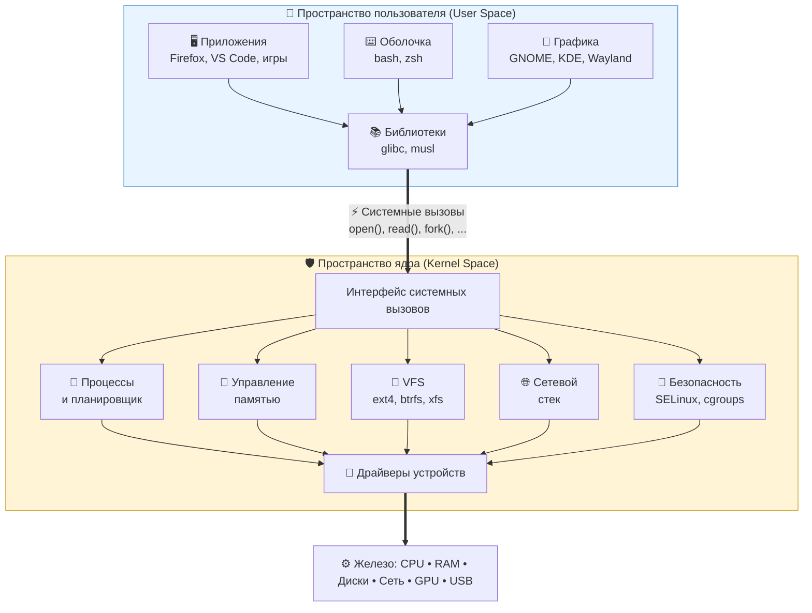

> [!IMPORTANT]
> **Ключевая идея:** программы никогда не трогают железо напрямую. Они просят ядро через **системные вызовы**, а ядро решает, можно ли, и делает работу. Именно так достигаются безопасность и многозадачность.

<details>
<summary>▶️ <b>Что происходит, когда ты пишешь <code>cat file.txt</code>?</b></summary>

<br/>

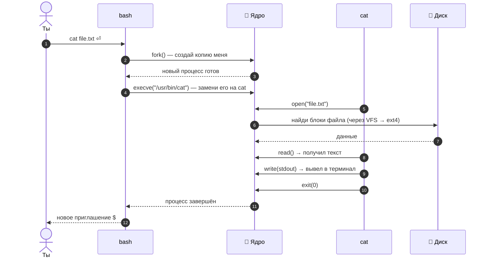

Посмотреть системные вызовы вживую: `strace cat /etc/hostname`

</details>

### 🗂 Иерархия файловой системы

<details>
<summary>▶️ <b>Раскрыть дерево папок с пояснениями</b></summary>

<br/>

```text
/
├── bin, sbin   → основные программы
├── boot        → ядро и загрузчик
├── dev         → устройства как файлы (/dev/sda, /dev/null)
├── etc         → настройки системы
├── home        → домашние папки пользователей
├── proc, sys   → «виртуальные» файлы — окно в ядро
├── tmp         → временные файлы
├── usr         → программы и библиотеки
└── var         → логи, кэши, базы данных
```

**«Всё есть файл»** — наследие Unix. Даже процессор, память и запущенные программы видны как файлы:

```bash
cat /proc/cpuinfo    # информация о процессоре
cat /proc/meminfo    # память
ls /proc/$$          # «папка» текущего процесса оболочки
```

</details>

---

## 🔌 Как Linux загружается

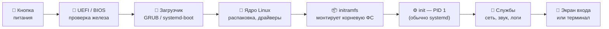

<details>
<summary>▶️ <b>История init: от SysV до systemd</b></summary>

<br/>

| Система | Годы | Особенность |
|---|---|---|
| **SysV init** | 1983 → 2010-е | Скрипты запускаются строго по очереди |
| **Upstart** | 2006–2014 | Ubuntu: запуск по событиям |
| **systemd** | 2010 → сейчас | Параллельный запуск, единое управление службами и логами |

systemd — одна из самых спорных тем в сообществе: одни ценят скорость и удобство, другие считают, что он нарушает философию Unix «одна программа — одна задача».

</details>

Посмотреть, сколько заняла загрузка у тебя:

```bash
systemd-analyze          # общее время
systemd-analyze blame    # кто тормозит
```

---

## 🔄 Жизнь процесса

Каждая запущенная программа — это **процесс**. Вот через какие состояния он проходит:

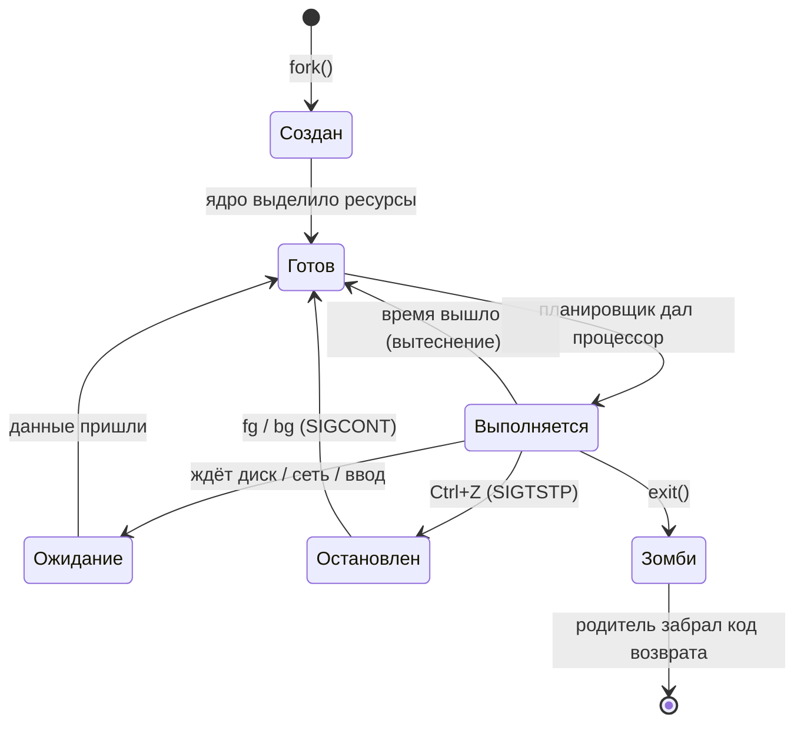

> [!NOTE]
> **Зомби** — не шутка, а официальный термин: процесс уже завершился, но родитель ещё не прочитал его код возврата. Найти их можно так: `ps aux | awk '$8=="Z"'`.

---

## 🛠 Как ядро разрабатывается сегодня

Ядро Linux — один из крупнейших совместных проектов в истории: в каждом релизе участвуют **тысячи разработчиков** из сотен компаний.

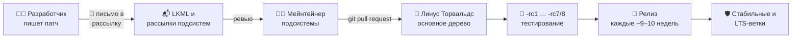

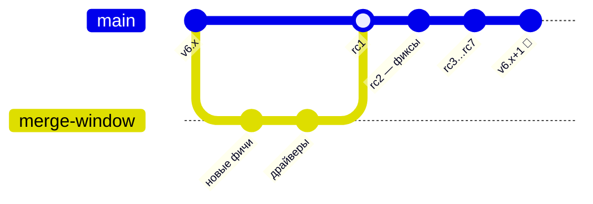

<details>
<summary>▶️ <b>Как отправить свой первый патч в ядро?</b></summary>

<br/>

```bash
git clone https://git.kernel.org/pub/scm/linux/kernel/git/torvalds/linux.git
cd linux
# ...вносим исправление...
git commit -s -m "subsystem: короткое описание"      # -s добавляет Signed-off-by
./scripts/checkpatch.pl -g HEAD                        # проверка стиля
./scripts/get_maintainer.pl -f путь/к/файлу.c          # кому отправлять
git send-email --to=мейнтейнер@... HEAD^               # отправка письмом
```

Хороший первый шаг — исправления в `drivers/staging/` или опечатки в документации.

</details>

> [!NOTE]
> Да, патчи в ядро до сих пор отправляют **по электронной почте** — как в 90-х. И это работает.

---

## 🌍 Где Linux сегодня

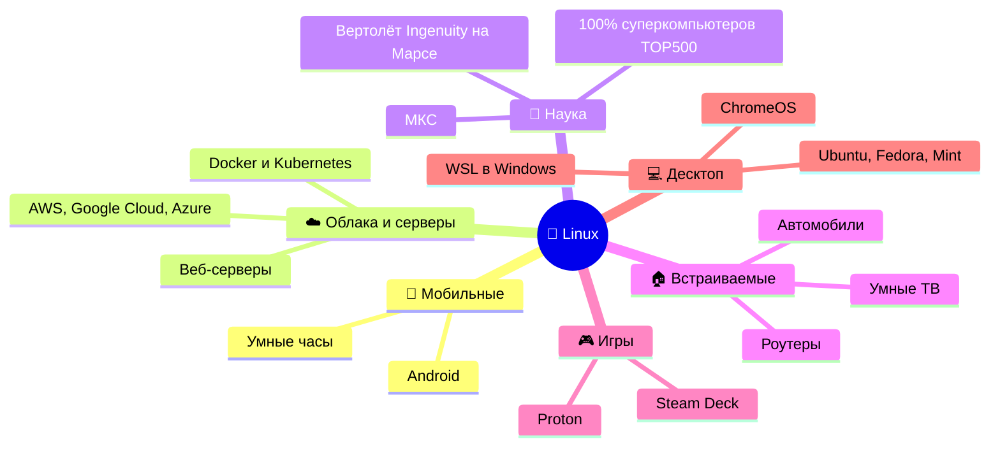

---

## 🆚 Linux, Windows, macOS

| | 🐧 Linux | 🪟 Windows | 🍏 macOS |
|---|---|---|---|
| **Появилась** | 1991 | 1985 | 2001 (корни — NeXTSTEP и BSD) |
| **Ядро** | Linux (монолитное) | NT (гибридное) | XNU (гибридное: Mach + BSD) |
| **Исходный код** | Открыт, GPL | Закрыт | Ядро открыто частично |
| **Цена** | Бесплатно | Платно | Вместе с Mac |
| **Настройка** | Можно поменять всё | Ограничена | Ограничена |
| **Unix-совместимость** | Unix-подобная | Через WSL | Сертифицированный UNIX |
| **Где сильна** | Серверы, облака, наука, встраиваемые | Офис, игры | Дизайн, видео, iOS-разработка |

---

## 🧪 Попробуй сам

Команды, которые показывают историю и устройство Linux прямо на твоём компьютере (или в WSL).

<details>
<summary>▶️ <b>🔍 Узнать о своей системе</b></summary>

<br/>

```bash
uname -r              # версия ядра
cat /etc/os-release   # какой у тебя дистрибутив
uptime                # сколько работает система
lsmod | head          # загруженные модули ядра
```

</details>

<details>
<summary>▶️ <b>🕰 Заглянуть в историю ядра</b></summary>

<br/>

```bash
# Скачать историю ядра без файлов (быстро, но всё равно несколько ГБ)
git clone --bare https://github.com/torvalds/linux.git
cd linux.git

git log --reverse --format="%ad %s" --date=short | head -3   # самый первый коммит в Git (2005)
git tag | grep -E '^v[0-9]+\.0$'                              # все «круглые» версии
git shortlog -sn --no-merges | head -10                       # топ-10 авторов
```

</details>

<details>
<summary>▶️ <b>🐮 Пасхалки и развлечения в терминале</b></summary>

<br/>

```bash
sudo apt install cowsay sl fortune   # Debian/Ubuntu

cowsay "Привет, Linux!"   # говорящая корова
sl                        # паровоз, если опечатался в ls
fortune                   # случайная цитата
```

</details>

<details>
<summary>▶️ <b>🖥 Попробовать Linux без установки</b></summary>

<br/>

- **В браузере:** [JSLinux](https://bellard.org/jslinux/) — настоящий Linux, запущенный в эмуляторе на JavaScript (автор — Фабрис Беллар, создатель QEMU и FFmpeg).
- **В Windows:** `wsl --install` в PowerShell от администратора.
- **С флешки:** записать ISO через [Ventoy](https://www.ventoy.net) или balenaEtcher и загрузиться в Live-режиме.

</details>

---

## 🤓 Интересные факты

<table>
<tr>
<td width="50%">

**🐧 Почему пингвин?**
Линус рассказывал, что его однажды клюнул пингвин в зоопарке. Логотип Tux нарисовал **Ларри Юинг** в 1996 году в редакторе GIMP.

</td>
<td width="50%">

**📛 Чуть не назвали Freax**
Линус хотел назвать систему *Freax* (free + freak + Unix). Название «Linux» дал администратор FTP-сервера Ари Лемке, создав папку `pub/OS/Linux`.

</td>
</tr>
<tr>
<td>

**⚡ Git за 10 дней**
В 2005 году ядро лишилось бесплатного доступа к BitKeeper. Линус написал Git — первая версия заработала примерно за неделю-полторы.

</td>
<td>

**🔴 Linux на Марсе**
Марсианский вертолёт **Ingenuity** (2021) летал под управлением Linux — первый полёт с двигателем на другой планете.

</td>
</tr>
<tr>
<td>

**🗣 GNU/Linux или Linux?**
Столлман настаивает на «GNU/Linux», ведь большая часть системных утилит — из проекта GNU. Спор идёт до сих пор.

</td>
<td>

**🔢 Почему версии прыгают**
Linux 3.0, 4.0, 5.0 и 6.0 — не революции. Линус просто считает, что номера становятся «слишком большими», и сбрасывает их.

</td>
</tr>
<tr>
<td>

**🗣 Как правильно произносить?**
Сам Линус записал аудио «Hello, this is Linus Torvalds, and I pronounce Linux as Linux» — по-русски ближе всего **«Ли́нукс»**.

</td>
<td>

**🦀 Второй язык ядра**
За 30 лет в ядро не пускали ничего, кроме C и ассемблера. **Rust** стал первым исключением (Linux 6.1, 2022).

</td>
</tr>
</table>

---

## 🎯 Квиз: проверь себя

Подумай над ответом, потом нажми, чтобы проверить. Считай правильные ответы!

<details>
<summary><b>1.</b> В каком году вышла первая версия Linux?</summary>

> ✅ **1991.** Linux 0.01 опубликован 17 сентября 1991 года.

</details>

<details>
<summary><b>2.</b> Как Линус хотел назвать свою систему изначально?</summary>

> ✅ **Freax** — от free, freak и Unix.

</details>

<details>
<summary><b>3.</b> Чего не хватало проекту GNU к 1991 году, чтобы стать полноценной ОС?</summary>

> ✅ **Ядра.** Компилятор, оболочка и утилиты уже были, а ядро Hurd не было готово.

</details>

<details>
<summary><b>4.</b> С кем Линус спорил о монолитных ядрах и микроядрах?</summary>

> ✅ С **Эндрю Таненбаумом**, автором MINIX (январь 1992).

</details>

<details>
<summary><b>5.</b> Какой дистрибутив — основа Ubuntu?</summary>

> ✅ **Debian.**

</details>

<details>
<summary><b>6.</b> Какую программу Линус написал в 2005 году, кроме ядра?</summary>

> ✅ **Git** — систему контроля версий, которой сейчас пользуется почти весь мир (включая GitHub, где ты это читаешь).

</details>

<details>
<summary><b>7.</b> Какой процесс в системе имеет номер PID 1?</summary>

> ✅ **init** — в большинстве современных дистрибутивов это **systemd**.

</details>

<details>
<summary><b>8.</b> Какая самая популярная в мире ОС на ядре Linux?</summary>

> ✅ **Android** — миллиарды устройств.

</details>

<details>
<summary><b>9.</b> Какой язык программирования, кроме C, официально приняли в ядро?</summary>

> ✅ **Rust**, начиная с Linux 6.1.

</details>

<details>
<summary><b>10.</b> На какой другой планете работал Linux?</summary>

> ✅ На **Марсе** — в вертолёте Ingenuity.

</details>

<details>
<summary>🏆 <b>Мой результат…</b></summary>

<br/>

| Правильных ответов | Твоё звание |
|:---:|---|
| 0–3 | 🥚 Новичок — перечитай README ещё раз, тут интересно! |
| 4–6 | 🐣 Юный пингвин — хорошая база |
| 7–9 | 🐧 Опытный линуксоид |
| 10 | 👑 Гуру — пора отправлять патчи в ядро |

</details>

---

## ✅ Чек-лист знатока

Скопируй себе (Fork) и отмечай, что уже сделал:

- [ ] Прочитал историю Linux от начала до конца
- [ ] Прошёл квиз на 7+ баллов
- [ ] Запустил Linux в виртуальной машине, WSL или с флешки
- [ ] Узнал версию своего ядра командой `uname -r`
- [ ] Соединил три команды через `|`
- [ ] Посмотрел системные вызовы через `strace`
- [ ] Попробовал 2 разных рабочих стола (например, GNOME и KDE)
- [ ] Нашёл первый коммит в истории ядра
- [ ] Посмотрел фильм «Revolution OS»

---

## 📚 Что почитать и посмотреть

<details open>
<summary><b>📖 Книги</b></summary>

- **«Just for Fun»** — Линус Торвальдс и Дэвид Даймонд, автобиография создателя Linux
- **«The Cathedral and the Bazaar»** — Эрик Рэймонд, эссе о модели разработки open source
- **«Современные операционные системы»** — Эндрю Таненбаум, классический учебник
- **«Linux Kernel Development»** — Роберт Лав, понятное введение в устройство ядра

</details>

<details open>
<summary><b>🎬 Фильмы</b></summary>

- **«Revolution OS»** (2001) — документальный фильм о свободном ПО и Linux
- **«The Code»** (2001) — финский документальный фильм о Linux

</details>

<details open>
<summary><b>🌐 Сайты</b></summary>

- [kernel.org](https://kernel.org) — официальный сайт ядра
- [The Linux Foundation](https://www.linuxfoundation.org)
- [GNU.org](https://www.gnu.org)
- [DistroWatch](https://distrowatch.com) — каталог всех дистрибутивов
- [Arch Wiki](https://wiki.archlinux.org) — лучшая документация по Linux
- [Elixir Bootlin](https://elixir.bootlin.com/linux/latest/source) — удобный просмотр исходников ядра в браузере

</details>

---

<div align="center">

### 🐧 *«Talk is cheap. Show me the code.»* — Линус Торвальдс

⭐ Если было интересно — поставь звезду репозиторию!

<sub>Нашёл ошибку или хочешь добавить факт? Открой Issue или Pull Request.</sub>

</div>
