<div align="center">


<br/>


**[🏛 Предыстория](#-предыстория-unix-и-gnu) • [🎂 Рождение](#-рождение-linux-1991) • [🕰 Хронология](#-хронология-развития) • [🌳 Дистрибутивы](#-генеалогическое-древо-дистрибутивов) • [🧩 Устройство](#-как-устроен-linux) • [🧪 Попробуй сам](#-попробуй-сам) • [🎯 Квиз](#-квиз-проверь-себя)**

</div>

---

> [!TIP]
> **Как читать этот README.** Всё, что начинается с ▶️, — кликабельно: раскрывай блоки, проходи квиз, а схемы можно увеличивать и двигать кнопками справа от них.

## 📖 Содержание

<details open>
<summary><b>Показать / скрыть оглавление</b></summary>

1. [Предыстория: Unix и GNU](#-предыстория-unix-и-gnu)
2. [Рождение Linux (1991)](#-рождение-linux-1991)
3. [Хронология развития](#-хронология-развития)
4. [Кто есть кто](#-кто-есть-кто)
5. [Как растёт ядро](#-как-растёт-ядро)
6. [Генеалогическое древо дистрибутивов](#-генеалогическое-древо-дистрибутивов)
7. [Какой дистрибутив выбрать: интерактивный тест](#-какой-дистрибутив-выбрать)
8. [Войны рабочих столов](#-войны-рабочих-столов)
9. [Как устроен Linux](#-как-устроен-linux)
10. [Как Linux загружается](#-как-linux-загружается)
11. [Жизнь процесса](#-жизнь-процесса)
12. [Как ядро разрабатывается сегодня](#-как-ядро-разрабатывается-сегодня)
13. [Где Linux сегодня](#-где-linux-сегодня)
14. [Linux, Windows, macOS: сравнение](#-linux-windows-macos)
15. [Попробуй сам](#-попробуй-сам)
16. [Интересные факты](#-интересные-факты)
17. [Квиз: проверь себя](#-квиз-проверь-себя)
18. [Чек-лист знатока](#-чек-лист-знатока)
19. [Что почитать и посмотреть](#-что-почитать-и-посмотреть)

</details>

---

## 🏛 Предыстория: Unix и GNU

Linux появился не на пустом месте. Он стоит на плечах двух гигантов — **Unix** и проекта **GNU**.

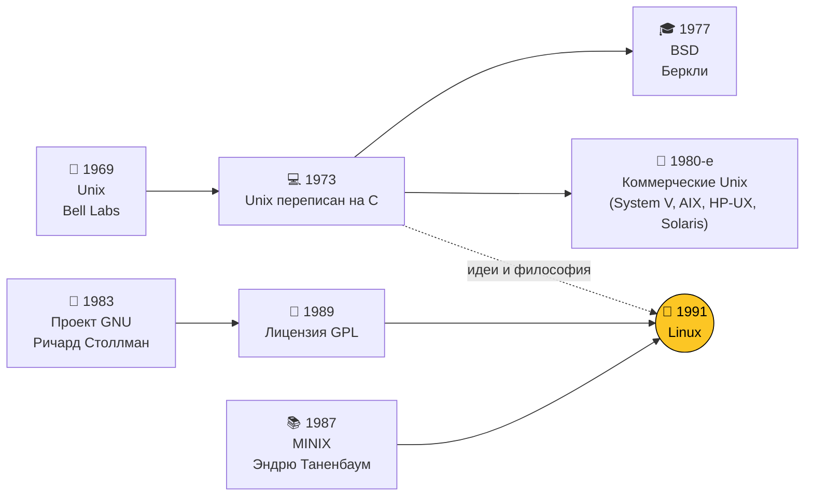

| Год | Событие | Почему это важно |
|:---:|---|---|
| **1969** | Кен Томпсон и Деннис Ритчи создают **Unix** в Bell Labs | Заложены принципы: «всё есть файл», маленькие утилиты, конвейеры |
| **1973** | Unix переписан на языке **C** | ОС впервые стала переносимой между разными компьютерами |
| **1977** | В Беркли появляется **BSD** | Свободная ветка Unix, предок FreeBSD и (частично) macOS |
| **1983** | Ричард Столлман объявляет проект **GNU** | Цель — полностью свободная Unix-подобная ОС |
| **1985** | Основан **Фонд свободного ПО (FSF)** | Юридическая и идейная опора свободного софта |
| **1987** | Эндрю Таненбаум выпускает **MINIX** | Учебная ОС, на которой учился и сам Линус |
| **1989** | Выходит **GNU GPL** | Лицензия «копилефт»: код остаётся свободным навсегда |

<details>
<summary>▶️ <b>Философия Unix в трёх правилах</b></summary>

<br/>

1. **Пиши программы, которые делают одну вещь, и делают её хорошо.**
2. **Пиши программы, которые работают вместе** — вывод одной становится вводом другой.
3. **Используй текст** как универсальный интерфейс.

Именно поэтому в Linux так любят конвейеры:

```bash
# 5 самых больших папок в домашнем каталоге
du -sh ~/* 2>/dev/null | sort -rh | head -5
```

Четыре маленькие программы, соединённые `|`, решают задачу, для которой ни одна из них не создавалась.

</details>

> [!NOTE]
> К 1991 году у GNU было почти всё — компилятор GCC, оболочка Bash, утилиты, — **кроме ядра**. Собственное ядро GNU Hurd так и не стало готовым. Эту дыру и закрыл Linux.

---

## 🎂 Рождение Linux (1991)

**25 августа 1991 года** 21-летний студент Хельсинкского университета **Линус Торвальдс** написал в новостную группу `comp.os.minix`, что делает свободную ОС для 386-х компьютеров —

> *«just a hobby, won't be big and professional like gnu»*

Скромнее начала не придумаешь 🙂

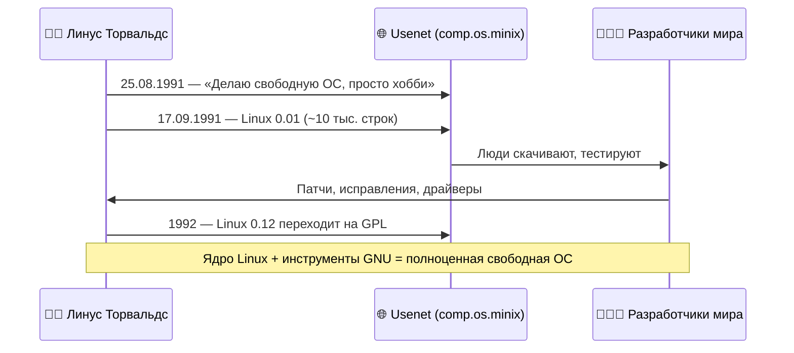

<details>
<summary>▶️ <b>Каким был компьютер Линуса в 1991 году?</b></summary>

<br/>

| Компонент | Тогда (1991) | Типичный ноутбук сегодня |
|---|---|---|
| Процессор | Intel 80386, 33 МГц | 8+ ядер, 3–5 ГГц |
| Память | 4 МБ | 16 ГБ — в **4000 раз** больше |
| Диск | ~40 МБ | 512 ГБ SSD |
| Цена | ~$3500 (купил в кредит) | — |

Linux 0.01 умел очень мало: работал только на 386-м, не поддерживал сеть, а для запуска нужен был установленный MINIX.

</details>

### ⚔️ Великий спор «Linux устарел» (1992)

В январе 1992 года Таненбаум опубликовал пост **«LINUX is obsolete»**: монолитное ядро — это шаг назад, будущее за **микроядрами**. Завязалась одна из самых известных дискуссий в истории ИТ.

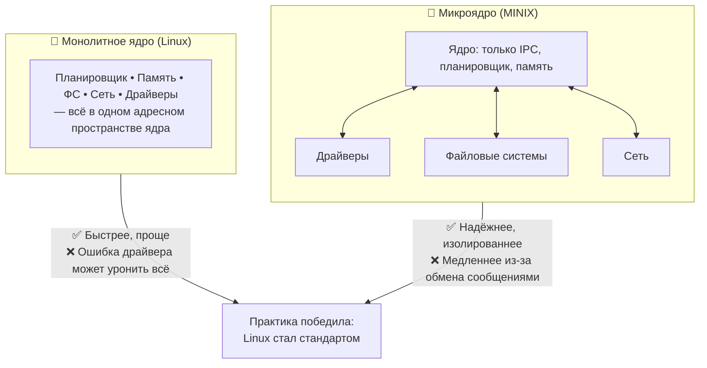

<details>
<summary>▶️ <b>А кто в итоге был прав?</b></summary>

<br/>

Оба — по-своему. Linux победил на практике: его проще было развивать, и он был быстрее на железе тех лет. Но идеи микроядер живут: на микроядре построены QNX (автомобили, промышленность) и seL4 (формально доказанное ядро), а MINIX 3 годами работал внутри Intel Management Engine — то есть, возможно, и в вашем процессоре.

</details>

> [!TIP]
> Современный Linux — монолитный, но **модульный**: драйверы можно загружать и выгружать на лету (`modprobe`, `lsmod`).

---

## 🕰 Хронология развития

### Часть 1. Становление (1991–2004)

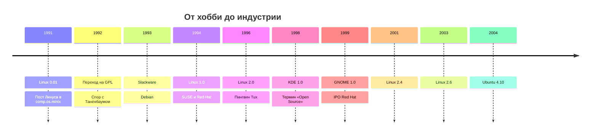

### Часть 2. Linux повсюду (2005–2022)

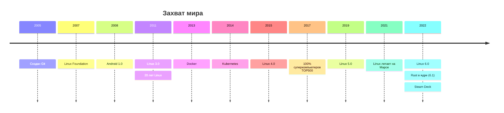

<details>
<summary>▶️ <b>🌱 1991–1994 — Детство</b></summary>

<br/>

Ядро растёт силами энтузиастов по всему миру. Появляются первые дистрибутивы: **SLS**, **Slackware** (старейший из живых), **Debian** (Иэн Мёрдок, 1993). В марте 1994 выходит **Linux 1.0** — около 176 тысяч строк кода и поддержка сети.

</details>

<details>
<summary>▶️ <b>🚀 1995–2000 — Взросление</b></summary>

<br/>

**Linux 2.0** (1996) получает поддержку нескольких процессоров (SMP). Ларри Юинг рисует пингвина **Tux**. Появляются графические окружения **KDE** и **GNOME**. Компании Red Hat и VA Linux выходят на биржу — бизнес поверил в Linux.

</details>

<details>
<summary>▶️ <b>🏢 2001–2007 — Linux идёт в корпорации</b></summary>

<br/>

Ядра **2.4** и **2.6**, IBM вкладывает миллиард долларов в Linux. В 2004 году **Ubuntu** делает Linux дружелюбным для обычных людей. В 2005-м после конфликта с BitKeeper Линус за пару недель пишет **Git**. В 2007-м появляется **Linux Foundation**, которая и сегодня платит Линусу зарплату.

</details>

<details>
<summary>▶️ <b>📱 2008–2016 — Linux в каждом кармане</b></summary>

<br/>

**Android** (на ядре Linux) захватывает смартфоны. Облака (AWS, Google Cloud, Azure) работают в основном на Linux. Появляются **Docker** (2013) и **Kubernetes** (2014) — контейнеры, которые возможны благодаря механизмам ядра `namespaces` и `cgroups`.

</details>

<details>
<summary>▶️ <b>🦀 2017–наши дни — Linux везде</b></summary>

<br/>

Все 500 самых мощных суперкомпьютеров — на Linux. Microsoft, когда-то называвшая Linux «раковой опухолью», выпускает **WSL** и сама становится крупным контрибьютором ядра. Valve выпускает **Steam Deck** на SteamOS (Arch Linux). В ядро приходит язык **Rust** для более безопасных драйверов.

</details>

---

## 👥 Кто есть кто

<table>
<tr>
<td align="center" width="25%">
<h3>👨‍💻</h3>
<b>Линус Торвальдс</b><br/>
<sub>Финляндия, р. 1969</sub>
</td>
<td align="center" width="25%">
<h3>🗽</h3>
<b>Ричард Столлман</b><br/>
<sub>США, р. 1953</sub>
</td>
<td align="center" width="25%">
<h3>📚</h3>
<b>Эндрю Таненбаум</b><br/>
<sub>Нидерланды, р. 1944</sub>
</td>
<td align="center" width="25%">
<h3>🌀</h3>
<b>Иэн Мёрдок</b><br/>
<sub>США, 1973–2015</sub>
</td>
</tr>
</table>

<details>
<summary>▶️ <b>Линус Торвальдс</b> — создатель ядра и Git</summary>

<br/>

Начал Linux студентом в 21 год. До сих пор принимает финальные решения о том, что попадёт в ядро. Знаменит прямотой — и тем, что в 2018 году публично извинился за резкий стиль общения и взял паузу, чтобы его поменять. Назван в честь Лайнуса Полинга, лауреата двух Нобелевских премий.

</details>

<details>
<summary>▶️ <b>Ричард Столлман</b> — отец свободного ПО</summary>

<br/>

Основал проект GNU и FSF, придумал GPL. Сформулировал «четыре свободы»: запускать, изучать, распространять и изменять программы. Именно GPL заставила компании, улучшающие Linux, возвращать свои изменения сообществу.

</details>

<details>
<summary>▶️ <b>Эндрю Таненбаум</b> — автор MINIX</summary>

<br/>

Профессор из Амстердама, автор классических учебников по ОС и сетям. Его MINIX вдохновил Линуса, а спор о микроядрах стал легендой. Позднее он сам признавал, что спор был скорее академическим.

</details>

<details>
<summary>▶️ <b>Иэн Мёрдок</b> — основатель Debian</summary>

<br/>

Создал Debian в 1993 году. Название — сочетание имён его тогдашней девушки **Деб**ры и его самого (**Ian**). Debian стал основой для Ubuntu, Mint и сотен других дистрибутивов.

</details>

---

## 📈 Как растёт ядро

Примерное количество строк исходного кода в ядре:

| Версия | Год | Строк кода (≈) | Масштаб |
|:---:|:---:|---:|---|
| 0.01 | 1991 | 10 тыс. | ▏ |
| 1.0 | 1994 | 176 тыс. | ▍ |
| 2.0 | 1996 | 780 тыс. | █ |
| 2.4 | 2001 | 3,4 млн | ███▌ |
| 2.6.0 | 2003 | 5,9 млн | ██████ |
| 3.0 | 2011 | 14,6 млн | ██████████████▌ |
| 4.0 | 2015 | 19,5 млн | ███████████████████▌ |
| 5.0 | 2019 | 26 млн | ██████████████████████████ |
| 6.x | 2022+ | 30+ млн | ██████████████████████████████+ |

Из чего состоит этот код (очень приблизительно):

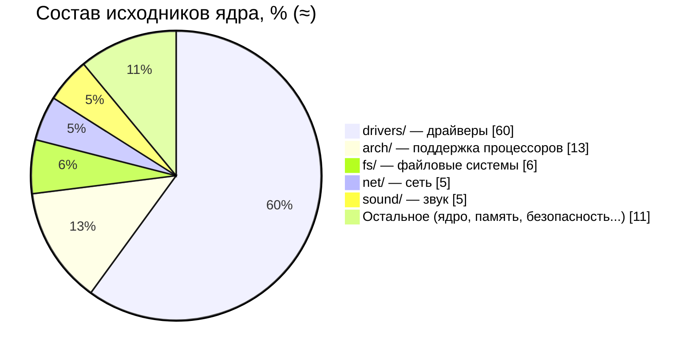

> [!NOTE]
> Больше половины ядра — **драйверы** устройств. Ядро, собранное под конкретный компьютер, использует лишь малую часть.

<details>
<summary>▶️ <b>Как читать номер версии ядра?</b></summary>

<br/>

```text
   6 . 8 . 12 - 300 - generic
   │   │   │     │       └─ вариант сборки от дистрибутива
   │   │   │     └───────── номер сборки дистрибутива
   │   │   └─────────────── патч-версия (исправления, стабильная ветка)
   │   └─────────────────── основная версия (выходит каждые ~9–10 недель)
   └─────────────────────── «большой» номер (меняется, когда Линусу так захочется)
```

До 2.6 существовало правило: чётные минорные номера (2.**4**, 2.**6**) — стабильные, нечётные (2.**5**) — экспериментальные. Сейчас его нет.

</details>

---

## 🌳 Генеалогическое древо дистрибутивов

Дистрибутив = **ядро Linux** + утилиты GNU + менеджер пакетов + программы + оформление.

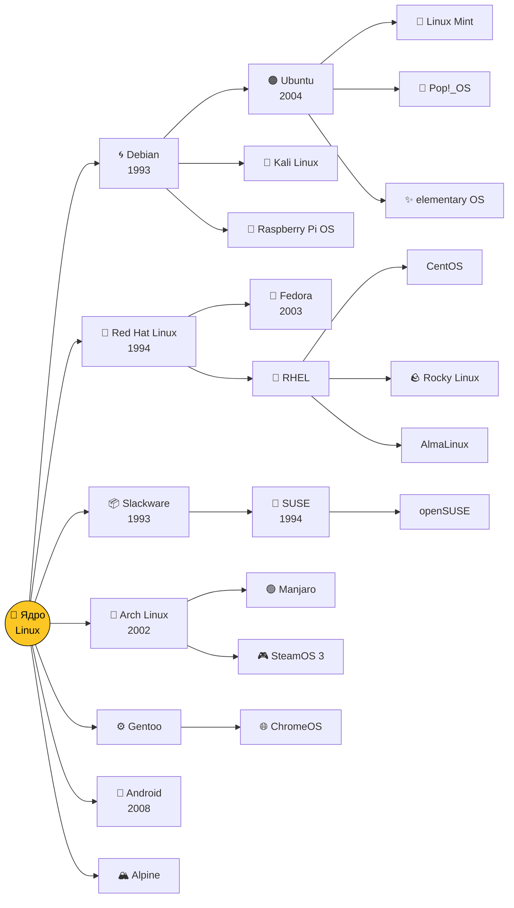

### 🗺 Карта дистрибутивов: сложность и свежесть

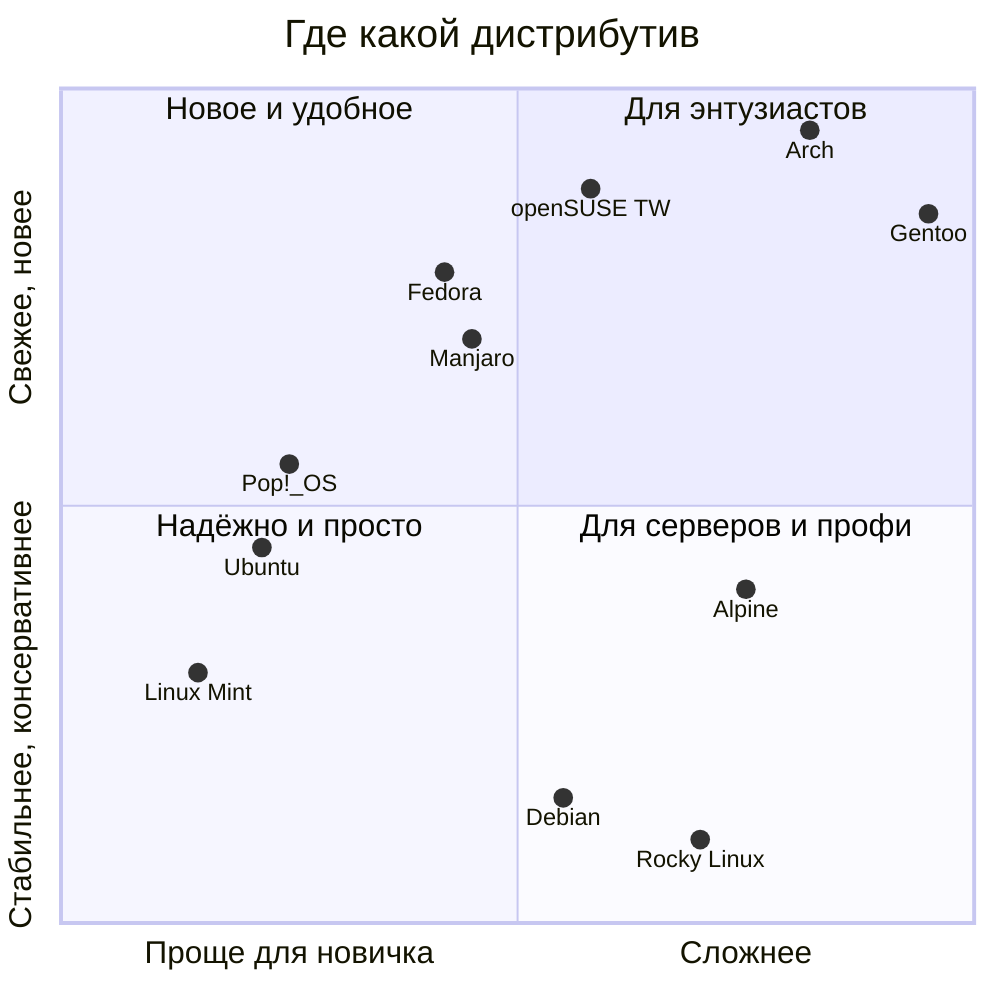

| Семейство | Пакеты | Характер | Для кого |
|---|---|---|---|
| **Debian / Ubuntu** | `.deb`, `apt` | Стабильный, огромное сообщество | Новички, серверы, разработчики |
| **Red Hat / Fedora** | `.rpm`, `dnf` | Корпоративный стандарт, свежие технологии | Компании, DevOps |
| **Arch** | `pacman`, AUR | «Собери сам», всегда самое новое | Энтузиасты, любители настройки |
| **SUSE** | `.rpm`, `zypper` | Удобный конфигуратор YaST | Европейский enterprise |
| **Alpine** | `apk` | Крошечный (несколько МБ) | Docker-контейнеры |

---

## 🧭 Какой дистрибутив выбрать?

Пройди тест — ответь на вопросы, раскрывая блоки:

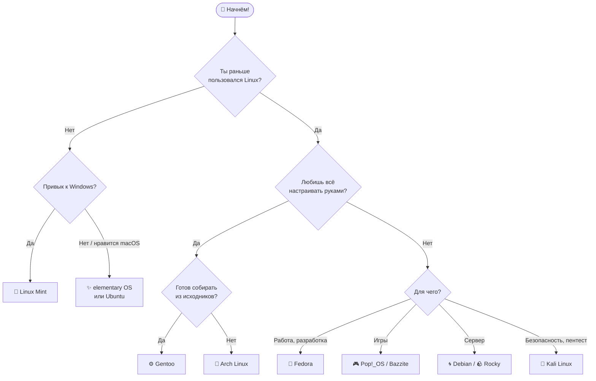

<details>
<summary>▶️ <b>Вопрос 1: Ты раньше пользовался Linux?</b></summary>

<br/>

<details>
<summary>👉 <b>Нет, впервые</b></summary>

<br/>

<details>
<summary>🪟 <b>Я привык к Windows</b></summary>

> 🎉 **Твой выбор — Linux Mint (Cinnamon).** Меню «Пуск», панель задач, всё на привычных местах. Работает даже на старом ноутбуке.

</details>

<details>
<summary>🍏 <b>Мне нравится стиль macOS</b></summary>

> 🎉 **Твой выбор — elementary OS** (или **Ubuntu** с GNOME). Аккуратный минималистичный интерфейс с док-панелью.

</details>

</details>

<details>
<summary>👉 <b>Да, уже пробовал</b></summary>

<br/>

<details>
<summary>🔧 <b>Хочу собрать систему под себя</b></summary>

> 🎉 **Твой выбор — Arch Linux.** Ставишь только то, что нужно, а [Arch Wiki](https://wiki.archlinux.org) — лучшая документация по Linux вообще. Хардкор? Тогда **Gentoo**.

</details>

<details>
<summary>💼 <b>Нужна рабочая машина для разработки</b></summary>

> 🎉 **Твой выбор — Fedora Workstation.** Свежие версии софта, чистый GNOME, отличная поддержка железа.

</details>

<details>
<summary>🎮 <b>Хочу играть</b></summary>

> 🎉 **Твой выбор — Pop!_OS или Bazzite.** Драйверы NVIDIA из коробки, Steam + Proton запускают большинство игр с Windows.

</details>

<details>
<summary>🖥 <b>Поднимаю сервер</b></summary>

> 🎉 **Твой выбор — Debian** (надёжность годами) или **Rocky Linux / AlmaLinux** (совместимость с RHEL).

</details>

</details>

</details>

> [!TIP]
> Не обязательно устанавливать: любой дистрибутив можно запустить с флешки в режиме **Live USB** или в виртуальной машине (VirtualBox) и просто посмотреть.

---

## 🖼 Войны рабочих столов

В Linux графический интерфейс — это просто программа, и её можно заменить. Поэтому интерфейсов много.

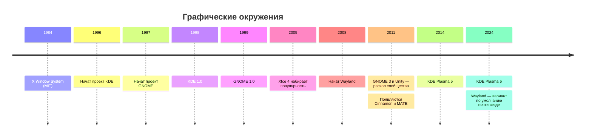

<details>
<summary>▶️ <b>Почему KDE и GNOME вообще соперничают?</b></summary>

<br/>

KDE был построен на библиотеке **Qt**, лицензия которой в 1990-х не была полностью свободной. Сторонники свободного ПО обеспокоились и запустили **GNOME** на свободной библиотеке GTK. Позже Qt стала свободной, но два лагеря остались — и это пошло на пользу: конкуренция двигает оба проекта вперёд.

| | GNOME | KDE Plasma | Xfce |
|---|---|---|---|
| Философия | Минимализм, «всё продумано за вас» | Настраивается абсолютно всё | Лёгкий и быстрый |
| Похож на | macOS / планшет | Windows на стероидах | Классический рабочий стол |
| Ресурсы | Средние | Средние | Минимальные |

</details>

---

## 🧩 Как устроен Linux

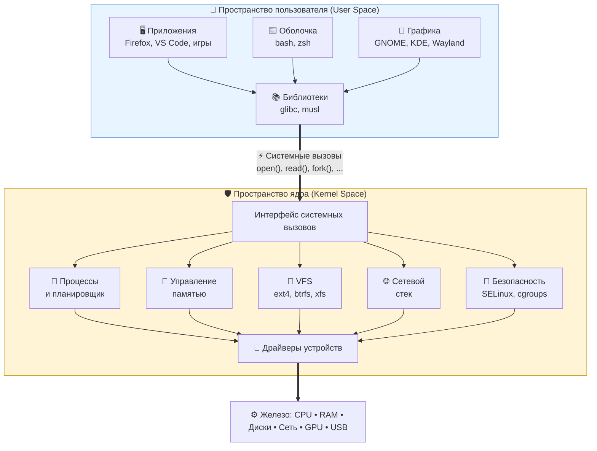

> [!IMPORTANT]
> **Ключевая идея:** программы никогда не трогают железо напрямую. Они просят ядро через **системные вызовы**, а ядро решает, можно ли, и делает работу. Именно так достигаются безопасность и многозадачность.

<details>
<summary>▶️ <b>Что происходит, когда ты пишешь <code>cat file.txt</code>?</b></summary>

<br/>

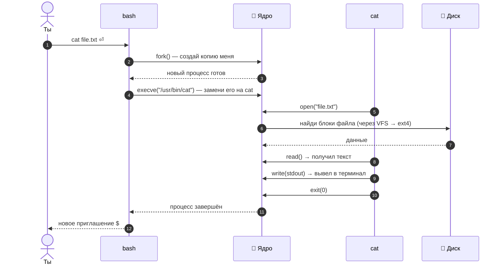

Посмотреть системные вызовы вживую: `strace cat /etc/hostname`

</details>

### 🗂 Иерархия файловой системы

<details>
<summary>▶️ <b>Раскрыть дерево папок с пояснениями</b></summary>

<br/>

```text
/
├── bin, sbin   → основные программы
├── boot        → ядро и загрузчик
├── dev         → устройства как файлы (/dev/sda, /dev/null)
├── etc         → настройки системы
├── home        → домашние папки пользователей
├── proc, sys   → «виртуальные» файлы — окно в ядро
├── tmp         → временные файлы
├── usr         → программы и библиотеки
└── var         → логи, кэши, базы данных
```

**«Всё есть файл»** — наследие Unix. Даже процессор, память и запущенные программы видны как файлы:

```bash
cat /proc/cpuinfo    # информация о процессоре
cat /proc/meminfo    # память
ls /proc/$$          # «папка» текущего процесса оболочки
```

</details>

---

## 🔌 Как Linux загружается

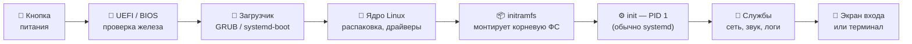

<details>
<summary>▶️ <b>История init: от SysV до systemd</b></summary>

<br/>

| Система | Годы | Особенность |
|---|---|---|
| **SysV init** | 1983 → 2010-е | Скрипты запускаются строго по очереди |
| **Upstart** | 2006–2014 | Ubuntu: запуск по событиям |
| **systemd** | 2010 → сейчас | Параллельный запуск, единое управление службами и логами |

systemd — одна из самых спорных тем в сообществе: одни ценят скорость и удобство, другие считают, что он нарушает философию Unix «одна программа — одна задача».

</details>

Посмотреть, сколько заняла загрузка у тебя:

```bash
systemd-analyze          # общее время
systemd-analyze blame    # кто тормозит
```

---

## 🔄 Жизнь процесса

Каждая запущенная программа — это **процесс**. Вот через какие состояния он проходит:

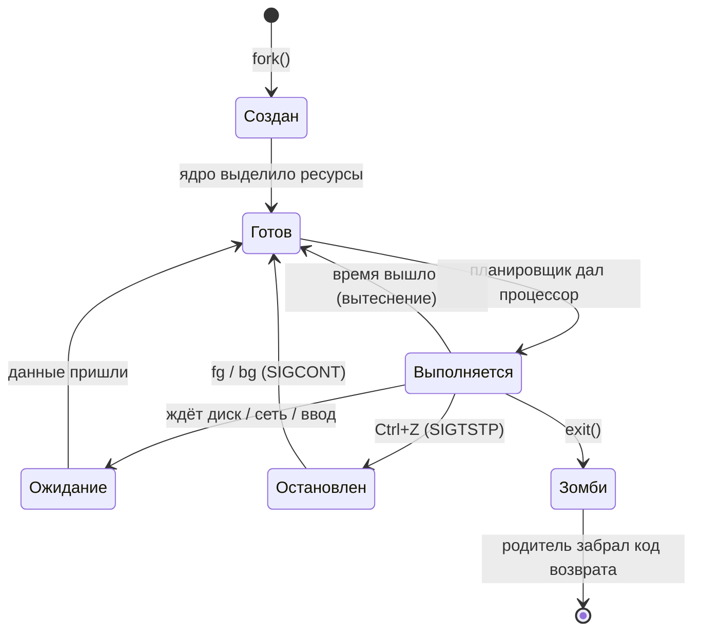

> [!NOTE]
> **Зомби** — не шутка, а официальный термин: процесс уже завершился, но родитель ещё не прочитал его код возврата. Найти их можно так: `ps aux | awk '$8=="Z"'`.

---

## 🛠 Как ядро разрабатывается сегодня

Ядро Linux — один из крупнейших совместных проектов в истории: в каждом релизе участвуют **тысячи разработчиков** из сотен компаний.

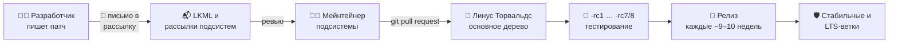

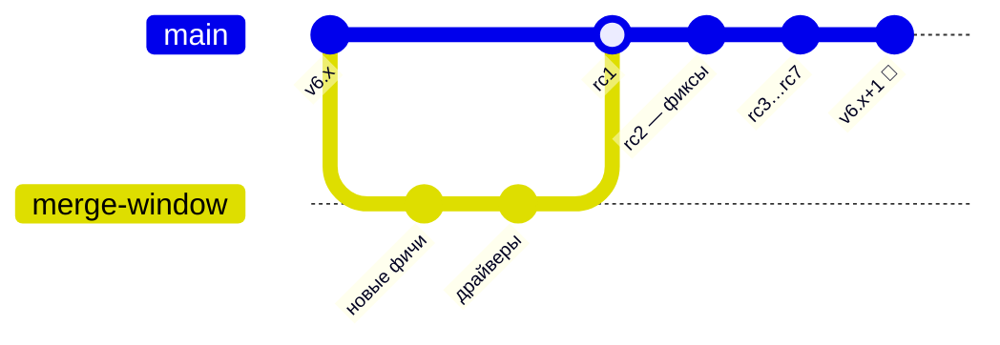

<details>
<summary>▶️ <b>Как отправить свой первый патч в ядро?</b></summary>

<br/>

```bash
git clone https://git.kernel.org/pub/scm/linux/kernel/git/torvalds/linux.git
cd linux
# ...вносим исправление...
git commit -s -m "subsystem: короткое описание"      # -s добавляет Signed-off-by
./scripts/checkpatch.pl -g HEAD                        # проверка стиля
./scripts/get_maintainer.pl -f путь/к/файлу.c          # кому отправлять
git send-email --to=мейнтейнер@... HEAD^               # отправка письмом
```

Хороший первый шаг — исправления в `drivers/staging/` или опечатки в документации.

</details>

> [!NOTE]
> Да, патчи в ядро до сих пор отправляют **по электронной почте** — как в 90-х. И это работает.

---

## 🌍 Где Linux сегодня

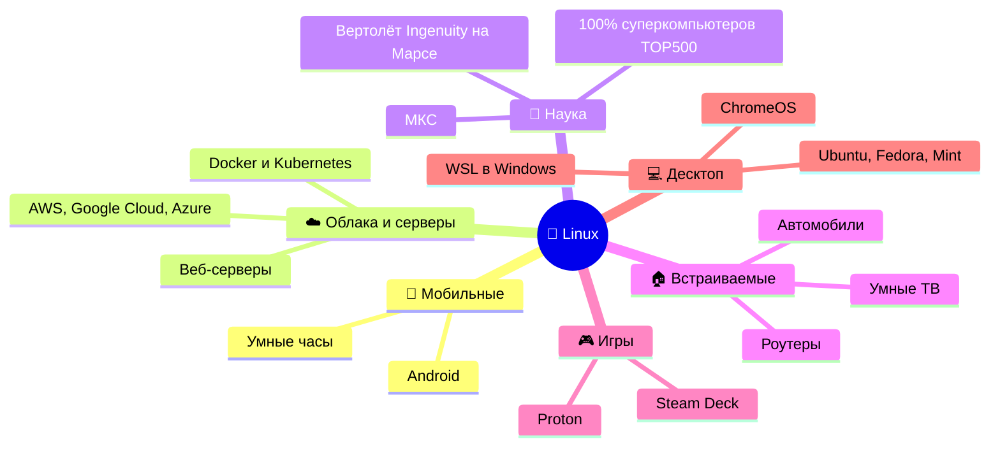

---

## ⚖️ Linux, Windows, macOS

| | 🐧 Linux | 🪟 Windows | 🍏 macOS |
|---|---|---|---|
| **Появилась** | 1991 | 1985 | 2001 (корни — NeXTSTEP и BSD) |
| **Ядро** | Linux (монолитное) | NT (гибридное) | XNU (гибридное: Mach + BSD) |
| **Исходный код** | Открыт, GPL | Закрыт | Ядро открыто частично |
| **Цена** | Бесплатно | Платно | Вместе с Mac |
| **Настройка** | Можно поменять всё | Ограничена | Ограничена |
| **Unix-совместимость** | Unix-подобная | Через WSL | Сертифицированный UNIX |
| **Где сильна** | Серверы, облака, наука, встраиваемые | Офис, игры | Дизайн, видео, iOS-разработка |

---

## 🧪 Попробуй сам

Команды, которые показывают историю и устройство Linux прямо на твоём компьютере (или в WSL).

<details>
<summary>▶️ <b>🔍 Узнать о своей системе</b></summary>

<br/>

```bash
uname -r              # версия ядра
cat /etc/os-release   # какой у тебя дистрибутив
uptime                # сколько работает система
lsmod | head          # загруженные модули ядра
```

</details>

<details>
<summary>▶️ <b>🕰 Заглянуть в историю ядра</b></summary>

<br/>

```bash
# Скачать историю ядра без файлов (быстро, но всё равно несколько ГБ)
git clone --bare https://github.com/torvalds/linux.git
cd linux.git

git log --reverse --format="%ad %s" --date=short | head -3   # самый первый коммит в Git (2005)
git tag | grep -E '^v[0-9]+\.0$'                              # все «круглые» версии
git shortlog -sn --no-merges | head -10                       # топ-10 авторов
```

</details>

<details>
<summary>▶️ <b>🐮 Пасхалки и развлечения в терминале</b></summary>

<br/>

```bash
sudo apt install cowsay sl fortune   # Debian/Ubuntu

cowsay "Привет, Linux!"   # говорящая корова
sl                        # паровоз, если опечатался в ls
fortune                   # случайная цитата
```

</details>

<details>
<summary>▶️ <b>🖥 Попробовать Linux без установки</b></summary>

<br/>

- **В браузере:** [JSLinux](https://bellard.org/jslinux/) — настоящий Linux, запущенный в эмуляторе на JavaScript (автор — Фабрис Беллар, создатель QEMU и FFmpeg).
- **В Windows:** `wsl --install` в PowerShell от администратора.
- **С флешки:** записать ISO через [Ventoy](https://www.ventoy.net) или balenaEtcher и загрузиться в Live-режиме.

</details>

---

## 🤓 Интересные факты

<table>
<tr>
<td width="50%">

**🐧 Почему пингвин?**
Линус рассказывал, что его однажды клюнул пингвин в зоопарке. Логотип Tux нарисовал **Ларри Юинг** в 1996 году в редакторе GIMP.

</td>
<td width="50%">

**📛 Чуть не назвали Freax**
Линус хотел назвать систему *Freax* (free + freak + Unix). Название «Linux» дал администратор FTP-сервера Ари Лемке, создав папку `pub/OS/Linux`.

</td>
</tr>
<tr>
<td>

**⚡ Git за 10 дней**
В 2005 году ядро лишилось бесплатного доступа к BitKeeper. Линус написал Git — первая версия заработала примерно за неделю-полторы.

</td>
<td>

**🔴 Linux на Марсе**
Марсианский вертолёт **Ingenuity** (2021) летал под управлением Linux — первый полёт с двигателем на другой планете.

</td>
</tr>
<tr>
<td>

**🗣 GNU/Linux или Linux?**
Столлман настаивает на «GNU/Linux», ведь большая часть системных утилит — из проекта GNU. Спор идёт до сих пор.

</td>
<td>

**🔢 Почему версии прыгают**
Linux 3.0, 4.0, 5.0 и 6.0 — не революции. Линус просто считает, что номера становятся «слишком большими», и сбрасывает их.

</td>
</tr>
<tr>
<td>

**🗣 Как правильно произносить?**
Сам Линус записал аудио «Hello, this is Linus Torvalds, and I pronounce Linux as Linux» — по-русски ближе всего **«Ли́нукс»**.

</td>
<td>

**🦀 Второй язык ядра**
За 30 лет в ядро не пускали ничего, кроме C и ассемблера. **Rust** стал первым исключением (Linux 6.1, 2022).

</td>
</tr>
</table>

---

## 🎯 Квиз: проверь себя

Подумай над ответом, потом нажми, чтобы проверить. Считай правильные ответы!

<details>
<summary><b>1.</b> В каком году вышла первая версия Linux?</summary>

> ✅ **1991.** Linux 0.01 опубликован 17 сентября 1991 года.

</details>

<details>
<summary><b>2.</b> Как Линус хотел назвать свою систему изначально?</summary>

> ✅ **Freax** — от free, freak и Unix.

</details>

<details>
<summary><b>3.</b> Чего не хватало проекту GNU к 1991 году, чтобы стать полноценной ОС?</summary>

> ✅ **Ядра.** Компилятор, оболочка и утилиты уже были, а ядро Hurd не было готово.

</details>

<details>
<summary><b>4.</b> С кем Линус спорил о монолитных ядрах и микроядрах?</summary>

> ✅ С **Эндрю Таненбаумом**, автором MINIX (январь 1992).

</details>

<details>
<summary><b>5.</b> Какой дистрибутив — основа Ubuntu?</summary>

> ✅ **Debian.**

</details>

<details>
<summary><b>6.</b> Какую программу Линус написал в 2005 году, кроме ядра?</summary>

> ✅ **Git** — систему контроля версий, которой сейчас пользуется почти весь мир (включая GitHub, где ты это читаешь).

</details>

<details>
<summary><b>7.</b> Какой процесс в системе имеет номер PID 1?</summary>

> ✅ **init** — в большинстве современных дистрибутивов это **systemd**.

</details>

<details>
<summary><b>8.</b> Какая самая популярная в мире ОС на ядре Linux?</summary>

> ✅ **Android** — миллиарды устройств.

</details>

<details>
<summary><b>9.</b> Какой язык программирования, кроме C, официально приняли в ядро?</summary>

> ✅ **Rust**, начиная с Linux 6.1.

</details>

<details>
<summary><b>10.</b> На какой другой планете работал Linux?</summary>

> ✅ На **Марсе** — в вертолёте Ingenuity.

</details>

<details>
<summary>🏆 <b>Мой результат…</b></summary>

<br/>

| Правильных ответов | Твоё звание |
|:---:|---|
| 0–3 | 🥚 Новичок — перечитай README ещё раз, тут интересно! |
| 4–6 | 🐣 Юный пингвин — хорошая база |
| 7–9 | 🐧 Опытный линуксоид |
| 10 | 👑 Гуру — пора отправлять патчи в ядро |

</details>

---

## ✅ Чек-лист знатока

Скопируй себе (Fork) и отмечай, что уже сделал:

- [ ] Прочитал историю Linux от начала до конца
- [ ] Прошёл квиз на 7+ баллов
- [ ] Запустил Linux в виртуальной машине, WSL или с флешки
- [ ] Узнал версию своего ядра командой `uname -r`
- [ ] Соединил три команды через `|`
- [ ] Посмотрел системные вызовы через `strace`
- [ ] Попробовал 2 разных рабочих стола (например, GNOME и KDE)
- [ ] Нашёл первый коммит в истории ядра
- [ ] Посмотрел фильм «Revolution OS»

---

## 📚 Что почитать и посмотреть

<details open>
<summary><b>📖 Книги</b></summary>

- **«Just for Fun»** — Линус Торвальдс и Дэвид Даймонд, автобиография создателя Linux
- **«The Cathedral and the Bazaar»** — Эрик Рэймонд, эссе о модели разработки open source
- **«Современные операционные системы»** — Эндрю Таненбаум, классический учебник
- **«Linux Kernel Development»** — Роберт Лав, понятное введение в устройство ядра

</details>

<details open>
<summary><b>🎬 Фильмы</b></summary>

- **«Revolution OS»** (2001) — документальный фильм о свободном ПО и Linux
- **«The Code»** (2001) — финский документальный фильм о Linux

</details>

<details open>
<summary><b>🌐 Сайты</b></summary>

- [kernel.org](https://kernel.org) — официальный сайт ядра
- [The Linux Foundation](https://www.linuxfoundation.org)
- [GNU.org](https://www.gnu.org)
- [DistroWatch](https://distrowatch.com) — каталог всех дистрибутивов
- [Arch Wiki](https://wiki.archlinux.org) — лучшая документация по Linux
- [Elixir Bootlin](https://elixir.bootlin.com/linux/latest/source) — удобный просмотр исходников ядра в браузере

</details>

---

<div align="center">

### 🐧 *«Talk is cheap. Show me the code.»* — Линус Торвальдс

⭐ Если было интересно — поставь звезду репозиторию!

<sub>Нашёл ошибку или хочешь добавить факт? Открой Issue или Pull Request.</sub>

</div>
